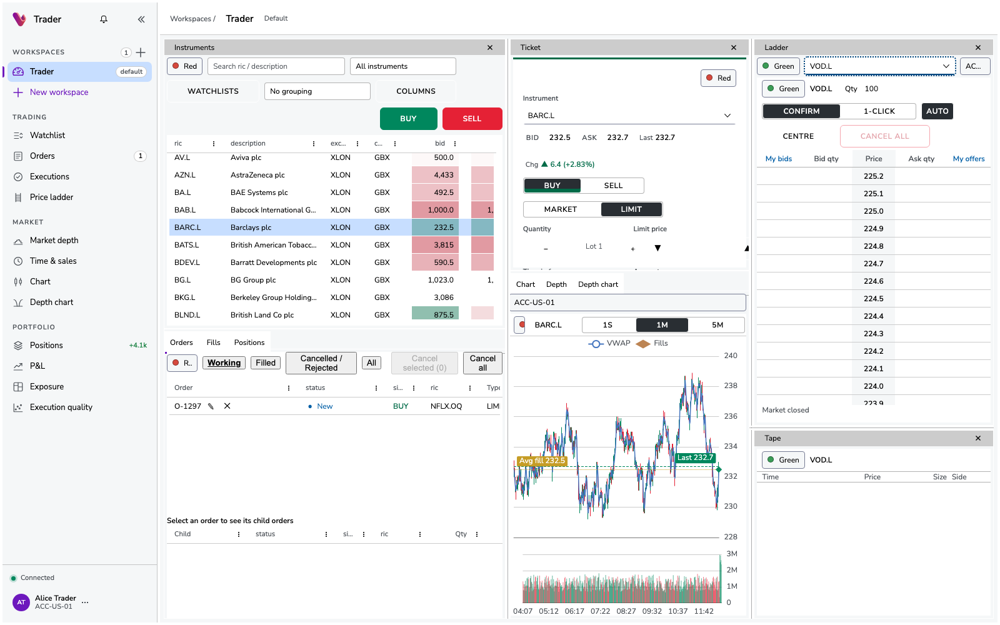

# trader

Reusable trading front-end (instrument grids, market depth / price ladder, order ticket, order & trade blotters) built on [Vuu](https://github.com/finos/vuu) UI components and the `vuu-portal`, exercised by a simulated backend (exchange simulator + OMS) running on [vuu-websocket](https://github.com/heswell/vuu-websocket).

Status: Phase 6 (workspaces). The trading UI runs in vuu-portal as role-gated module-federation features under a
`PortalNav` (Workspaces: Trader, plus the user's own; Trading: Watchlist, Orders, Executions, Price ladder;
Market: Market depth, Time & sales, Chart, Depth chart; Portfolio: Positions, P&L, Exposure, Execution quality; Oversight: Desk overview; Simulator: Overview, Bots, Instrument). The
features connect to a standalone trading Vuu server (exchange simulator + OMS), separate from the portal's own Vuu
server, through @vuu-ui's per-module `config.json`. One command starts the whole stack. See
[docs/portal-integration.md](docs/portal-integration.md).



## Quick start

```sh
bun install
bun run start:all        # or: bun run dev
```

Open http://localhost:5100 and log in as `alice` / `password`. The first time, open https://localhost:8180,
https://localhost:8543, https://localhost:8191, https://localhost:8544 and https://localhost:8192 and accept the
self-signed dev certificate. `start:all` needs
Keycloak 26.x: `KEYCLOAK_HOME`, a `~/keycloak/keycloak-*` install, an already-running Keycloak
(`TRADER_KEYCLOAK_URL`), or `docker compose up -d keycloak`. It creates the realm, clients, roles and users itself.
The trading roles belong to the trading server's own Keycloak client (`trader-trading-server`), which receives the
portal user's token by token exchange.

| User (password `password`) | Can |
| --- | --- |
| alice, bob, carol, erin | view and trade (ticket, ladder, amend / cancel) |
| dave | view only |
| sam | view, plus Oversight › Desk overview |
| admin | supervision, the Simulator screens (`sim-admin`), and portal module admin |

| What | Where |
| --- | --- |
| portal host (PortalShell) | http://localhost:5100 |
| trading features (MF remotes) | http://localhost:5110/&lt;feature&gt;/ |
| portal Vuu server (module registry) | `wss://localhost:8191/websocket-portal`, `https://localhost:8543` |
| trading Vuu server (EXCHANGE + OMS) | `wss://localhost:8192/websocket-trading`, `https://localhost:8544` |
| Keycloak (admin / admin) | https://localhost:8180 |

All ports can be changed with `TRADER_*` env vars, and busy ports are reported, not taken over. Flags: `--build`
(rebuild the features), `--reseed` (reset the portal module list) and `--prepare` (build and generate config only,
for the `Procfile`) and `--restart-trading` (restart the trading server when it exits on a signal; its pid is in
`.run/trading.pid`). Ctrl-C stops everything. See
[docs/portal-integration.md](docs/portal-integration.md#running) for details and troubleshooting.

## Documentation

Start with [docs/README.md](docs/README.md), the index of all docs.

| I want to | Read |
| --- | --- |
| Understand the system | [Architecture](docs/architecture.md): processes and ports, data, order, auth and persistence flows, package map, design decisions |
| Use the components in my own app | [Getting started](docs/getting-started.md) (remote vuu-server or engine-local), then the [component guides](docs/components/README.md) and the generated [API reference](docs/api/README.md) |
| See every component running | The [showcase](apps/showcase/README.md): `bun run dev:showcase`, http://localhost:5001, no servers needed |
| Write or change a component | [UI guide](docs/ui-guide.md) |
| Run, configure, reset or debug the stack | The [operations runbook](docs/operations.md) |
| Know about dependency problems | [Upstream issues](docs/upstream-issues.md) |

## Layout

```
packages/
  trading-schemas/    shared table defs, enums, RPC contracts, tick/lot utils
  persistence/        journal + snapshot stores (memory, file, sqlite) for the trading server
  exchange-sim/       exchange simulator: order books, bots, EXCHANGE module, OMS gateway (see its README)
  oms/                OMS module: orders, risk, routing, positions, background flow (see its README)
  trading-ui/         reusable React components, data hooks, instrument linking, TradingFeatureRoot (docs/components/)
  trading-test-data/  in-browser EXCHANGE + OMS (real engines on @heswell/vuu-data-engine-local)
  perf/               perf tools: WS load harness, UI tick-rate profiler, ladder frame budget (docs/performance.md)
apps/
  features/trading/   the portal features: catalog.ts -> one MF remote per feature (served on :5110)
  portal-host/        the portal host: PortalShell, Keycloak login, nav (:5100)
  portal-config/      portal + trading server configs and launchers, default-modules.yaml (generated)
  showcase/           rsbuild dev app: trading-ui examples on local data or a server, :5001
infra/keycloak/       realm export (roles, clients, seeded users) for docker-compose
docs/                 architecture, getting-started, operations, components/ (guides), api/ (generated), ...
scripts/              start-all, stack/ (config, Keycloak realm, static server), features/ (sync, build), e2e/, docs/, certs
```

## Prerequisites

- [bun](https://bun.sh) >= 1.3 (CI uses 1.3.14), openssl, Keycloak 26.x (realm `vuu`) for portal login.
- **trader must be installed with `bun install` only.** npm, yarn and pnpm are unsupported (workspace protocol);
  a `preinstall` guard fails fast with a clear message.

All dependencies come from npm:

- **Server side**, from [heswell/vuu-websocket](https://github.com/heswell/vuu-websocket):
  `@heswell/vuu-server@^4.2.2` and `@heswell/vuu-portal@^2.2.3`, which bring `@heswell/service-utils`,
  `@heswell/vuu-table`, `@heswell/vuu-viewport` and `@heswell/module-admin`.
- **UI**: `@vuu-ui/*@4.0.0-alpha.31` (including `@vuu-ui/vuu-chart`, on echarts) and `@vuu-ui/portal-build`.
- **Matching** uses `@heswell/hft-limit-order-book`, and engine-local mode uses `@heswell/vuu-data-engine-local`.

The @heswell packages only peer `@vuu-ui/*`. Every workspace that uses vuu-server therefore lists the `@vuu-ui`
packages it needs at alpha.31, and the install has one copy of each. No `overrides` are needed.

## Common commands

| Command | |
| --- | --- |
| `bun run start:all` | The whole stack ([operations](docs/operations.md#start-and-stop)) |
| `bun run dev:showcase` | Component showcase on in-browser data |
| `bun run typecheck`, `lint`, `format:check`, `test` | The checks CI runs, with `features:check`, `build`, `docs:check` and `perf:ws --preset=smoke --assert` |
| `bun run docs:api` | Regenerate the [API reference](docs/api/README.md) after changing an export |
| `bun run persistence:reset` | Clear the trading server's persisted order state |

Every script is listed in the [scripts reference](#scripts-reference) below. How to use the e2e and perf
tools, and troubleshooting, are in the [operations runbook](docs/operations.md#checks-tests-perf-and-e2e).

## Scripts reference

All scripts run with bun (`preinstall` refuses npm and yarn). Flags take the form `--key=value`, and a bare
`--flag` means true. Defaults are in brackets.

### Dev stack

| Script | What it does | Params |
| --- | --- | --- |
| `dev`, `start:all` | Whole local stack ([start-all.ts](scripts/start-all.ts)): Keycloak, portal and trading Vuu servers, portal host, feature remotes | `--build` rebuild host and features first; `--reseed` reset the portal module list to the defaults; `--prepare` certs, builds and module list only, then exit; `--keycloak-only` Keycloak and realm only; `--restart-trading` respawn the trading server when it exits. Env: `TRADER_*` ([config.ts](scripts/stack/config.ts)), `KEYCLOAK_HOME`, `KEYCLOAK_ADMIN_USERNAME`, `KEYCLOAK_ADMIN_PASSWORD` |
| `dev:showcase` | Showcase app (`rsbuild dev`) on in-browser data | none |
| `dev:trading-server` | OMS and exchange-sim Vuu server on their own | Env: `VUU_CONFIG_FILE`, `TRADER_PERF_STATS_FILE`, `TRADER_PERF_STATS_INTERVAL_MS`, `EXCHANGE_SIM_*` |
| `dev:trading-server:1m` | `dev:trading-server` with a 1M-row trades seed (`EXCHANGE_SIM_TRADES_SEED=1000000`) | none |
| `certs` | Generate the local TLS certs | `--force` regenerate existing certs |
| `keycloak:realm` | Manage the Keycloak realm | `export`, or `bootstrap [--reset]` (`--reset` drops and recreates). Env: `TRADER_DEV_PASSWORD` [password], `KEYCLOAK_ADMIN_*` |
| `persistence:reset` | Clear the trading server's persisted state | Optional directory argument, else `TRADER_DATA_DIR` or `PERSISTENCE_DIR` |

### Build and quality

| Script | What it does | Params |
| --- | --- | --- |
| `build` | `features:sync`, then build the portal host and the feature remotes | none |
| `features:sync`, `features:check` | Regenerate the feature build config from the catalog; `features:check` only reports drift | `--check` |
| `typecheck` | `tsc --noEmit` | none |
| `lint` | `biome lint .` | none |
| `format`, `format:check` | Biome format: `format` writes, `format:check` only checks | none |
| `docs:api` | Regenerate [docs/api](docs/api/README.md) | `--check` fail if out of date |
| `docs:check` | `docs:api --check` plus the relative link and anchor check | none |

### Tests

| Script | What it does | Params |
| --- | --- | --- |
| `test` | `test:server`, then `test:ui` | none |
| `test:server` | `bun test` over schemas, exchange-sim, oms, persistence, metrics, test-data and features | Extra `bun test` args pass through |
| `test:ui` | `bun test` with the happy-dom preload over trading-ui and portal-host | Extra `bun test` args pass through |
| `e2e:persistence` | Playwright persistence check | `--no-build`, `--headed` |
| `e2e:palette` | Playwright palette check | `--no-build`, `--headed` |
| `e2e:resilience` | Kill and restart the servers; check reconnect, stale views and the ticket | `--no-build`, `--headed`, `--restarts` [3], `--portal-restarts` [1], `--no-session-limit`. Env: `E2E_PORT_OFFSET` [30], `E2E_VERBOSE` |

### Perf

| Script | Params |
| --- | --- |
| `perf:ws` | `--preset=smoke\|heavy` [smoke: 5 clients, 5 viewports, 10s; heavy: 50, 8, 30s], `--target=local\|stack` [local], `--clients`, `--viewports`, `--duration`, `--warmup`, `--tick`, `--mm-rate`, `--taker-rate`, `--publish-ms`, `--active`, `--workers`, `--users=a,b`, `--sessions-per-user`, `--max-p95-ms` [1000], `--stats-file`, `--assert` |
| `perf:ui` | `--data=remote\|local` [remote], `--scenario` [trader-workspace], `--tick` [4], `--duration` [15], `--warmup` [5], `--throttle` [1], `--cpu-profile`, `--reuse-build`, `--headed` |
| `perf:ladder` | `--rates` [50,100,200], `--seconds` [10], `--budget` ms [16], `--throttle` [1], `--max-dropped-pct`, `--assert`, `--reuse-build`, `--headed` |
| `perf:export` | `--rows` [500000], `--mode=http\|http-raw\|ws-range\|both` [http], `--clients` [4], `--tick` [4], `--baseline` s [15], `--exports` [3], `--ws-exports` [1], `--settle` s [15], `--table` [trades], `--filter` |

### Workspace scripts

Run these with `bun run --filter <package> <script>`.

| Package | Scripts |
| --- | --- |
| `@heswell/oms` | `start` (what `dev:trading-server` runs), `test` |
| `@heswell/exchange-sim` | `start` (the sim on its own), `test`, `bench` (`--mode` [both], `--seconds` [10], `--subscribe`, `--timers` [off]) |
| `@heswell/trading-perf` | `ws`, `ui`, `ladder`: aliases of the root `perf:*` scripts |
| `@heswell/trading-showcase` | `dev`, `build`, `preview` (rsbuild) |
| `@heswell/trading-portal-config` | `start` (`vuu-portal --config ./application.conf`), `start:trading` |
| `@heswell/trading-portal-host` | `build` (portal-build) |
| `@heswell/trading-features` | `build [key ...]`: build only the named feature remotes, or all of them |
| metrics, persistence, trading-schemas, trading-test-data | `test` |

## Verified

Each phase was verified end to end. The details are kept with the docs:

- the portal stack with real Keycloak login and token exchange, driven by headless Chrome
  ([portal-integration](docs/portal-integration.md#verified));
- reconnect and resubscribe under server kills ([resilience](docs/resilience.md#6-testing));
- crash recovery with `kill -9` ([persistence](docs/persistence.md#verified));
- throughput and frame budgets ([performance](docs/performance.md#baselines)).

Not verified: `docker-compose.yml` (no Docker) and the `Procfile` under a process manager.

## CI

`.github/workflows/ci.yml` runs these steps:

1. install;
2. typecheck, lint, format-check and the tests;
3. `features:check` on the generated feature config;
4. `docs:check`: the generated API reference is current, and relative links and anchors resolve;
5. build the host and features;
6. the `perf:ws` smoke preset (5 clients × 5 viewports, `--assert`).
