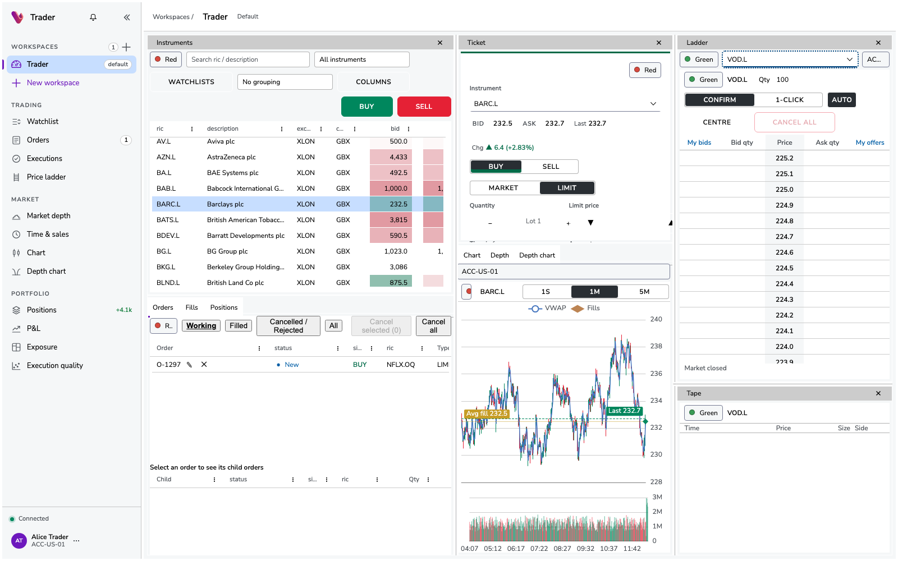

# trader

Reusable trading front-end (instrument grids, market depth / price ladder, order ticket, order & trade blotters) built on [Vuu](https://github.com/finos/vuu) UI components and the `vuu-portal`, exercised by a simulated backend (exchange simulator + OMS) running on [vuu-websocket](https://github.com/heswell/vuu-websocket).

Status: Phase 4. The trading UI runs in vuu-portal as role-gated module-federation features (Watchlist, Depth,
Ladder, Ticket, Orders, Fills, Positions, Tape, a prebuilt trader Workspace and a supervisor desk overview). The
features connect to a standalone trading Vuu server (exchange simulator + OMS), separate from the portal's own Vuu
server, through @vuu-ui's per-module `config.json`. One command starts the whole stack. See
[docs/portal-integration.md](docs/portal-integration.md).



## Quick start

```sh
bun install
bun run start:all        # or: bun run dev
```

Open http://localhost:5100 and log in as `alice` / `password`. The first time, open https://localhost:8180,
https://localhost:8543, https://localhost:8191, https://localhost:8544 and https://localhost:8192 and accept the
self-signed dev certificate. `start:all` needs
Keycloak 26.x: `KEYCLOAK_HOME`, a `~/keycloak/keycloak-*` install, an already-running Keycloak
(`TRADER_KEYCLOAK_URL`), or `docker compose up -d keycloak`. It creates the realm, clients, roles and users itself.
The trading roles belong to the trading server's own Keycloak client (`trader-trading-server`), which receives the
portal user's token by token exchange.

| User (password `password`) | Can |
| --- | --- |
| alice, bob, carol, erin | view and trade (ticket, ladder, amend / cancel) |
| dave | view only |
| sam | view, plus Supervision › Desk overview |
| admin | supervision and portal module admin |

| What | Where |
| --- | --- |
| portal host (PortalShell) | http://localhost:5100 |
| trading features (MF remotes) | http://localhost:5110/&lt;feature&gt;/ |
| portal Vuu server (module registry) | `wss://localhost:8191/websocket-portal`, `https://localhost:8543` |
| trading Vuu server (EXCHANGE + OMS) | `wss://localhost:8192/websocket-trading`, `https://localhost:8544` |
| Keycloak (admin / admin) | https://localhost:8180 |

All ports can be changed with `TRADER_*` env vars, and busy ports are reported, not taken over. Flags: `--build`
(rebuild the features), `--reseed` (reset the portal module list) and `--prepare` (build and generate config only,
for the `Procfile`). Ctrl-C stops everything. See
[docs/portal-integration.md](docs/portal-integration.md#running) for details and troubleshooting.

## Layout

```
packages/
  trading-schemas/    shared table defs, enums, RPC contracts, tick/lot utils
  exchange-sim/       exchange simulator: order books, bots, EXCHANGE module, OMS gateway (see its README)
  oms/                OMS module: orders, risk, routing, positions, background flow (see its README)
  trading-ui/         reusable React components, data hooks, instrument linking, TradingFeatureRoot (docs/ui-guide.md)
  trading-test-data/  in-browser EXCHANGE + OMS (real engines on @heswell/vuu-data-engine-local)
apps/
  features/trading/   the portal features: catalog.ts -> one MF remote per feature (served on :5110)
  portal-host/        the portal host: PortalShell, Keycloak login, nav (:5100)
  portal-config/      portal + trading server configs and launchers, default-modules.yaml (generated)
  showcase/           rsbuild dev app: trading-ui examples on local data or a server, :5001
infra/keycloak/       realm export (roles, clients, seeded users) for docker-compose
docs/                 ui-guide, portal-integration, protocol-parity, upstream-issues, screenshots/
scripts/              start-all, stack/ (config, Keycloak realm, static server), features/ (sync, build), certs
```

## Prerequisites

- [bun](https://bun.sh) >= 1.3 (CI uses 1.3.14), openssl, Keycloak (realm `vuu`) for portal login.
- **trader must be installed with `bun install` only.** npm, yarn and pnpm are unsupported (workspace protocol);
  a `preinstall` guard fails fast with a clear message.

All dependencies come from npm: the server side from [heswell/vuu-websocket](https://github.com/heswell/vuu-websocket)
(`@heswell/vuu-server@^4.1.0`, `@heswell/vuu-portal@^2.1.1`, which bring `@heswell/service-utils`), the UI from
`@vuu-ui/*@4.0.0-alpha.21` and `@vuu-ui/portal-build`. The @heswell packages only peer `@vuu-ui/*`
(`^4.0.0-alpha.20`), so every workspace that uses vuu-server lists the `@vuu-ui` packages it needs at alpha.21 and the
install has one copy of each; there are no root `overrides`.

```sh
bun install
```

The portal server is the stock vuu-portal: `bunx vuu-portal --config apps/portal-config/application.conf`
(or `bun run --filter @heswell/trading-portal-config start`). The trading server is
`bun apps/portal-config/src/start-trading.ts` (`application.trading.conf`). Both confs take `${?VUU_*}` env overrides
(`VUU_HTTPS_PORT`, `VUU_WEBSOCKET_PORT`, `VUU_CORS_ALLOWED_ORIGINS`, `VUU_KEYCLOAK_URL`, ...); `start:all` sets them
per process from the `TRADER_*` settings. See [Sessions per user](docs/portal-integration.md#sessions-per-user) for
`VUU_MAX_SESSIONS_PER_USER` / `VUU_SESSION_LIMIT_POLICY`.

## Other commands

- `bun run build`: the portal host and features.
- `bun run features:sync`: regenerate `portal-build.json` and `default-modules.yaml` from the feature catalog.
  `features:check` verifies them.
- `bun run typecheck`: `tsc --noEmit` against the published `.d.ts` of the vuu packages.
- `bun run lint`, `bun run format`.
- `bun run test`: `test:server` + `test:ui`, the latter with a happy-dom preload.
- `bun run keycloak:realm export|bootstrap`: write `infra/keycloak/realm-vuu.json`, or apply it to a running
  Keycloak.

UI showcase: `bun run dev:showcase` (http://localhost:5001, local data; its "Remote server" toggle uses
`bun run dev:trading-server`).

Stand-alone exchange-sim (permissive auth over plain HTTP, `ws://localhost:8094/websocket-exchange-sim`):
`bun run --filter @heswell/exchange-sim start`. Benchmark: `bun run --filter @heswell/exchange-sim bench`.
Simulator knobs (`exchangeSim.*` / `EXCHANGE_SIM_*`) are documented in
[packages/exchange-sim/README.md](packages/exchange-sim/README.md).

Stand-alone EXCHANGE + OMS (permissive auth over plain HTTP, `ws://localhost:8095/websocket-trading`):
`bun run --filter @heswell/oms start`. OMS knobs (`oms.*` / `OMS_*`), RPCs, roles (`trading-view` /
`trading-execute` / `trading-supervisor`) and seeded accounts (owners alice, bob, carol, dave, erin) are in
[packages/oms/README.md](packages/oms/README.md).

### Verified / not verified

Verified (Phase 4, re-run on @vuu-ui 4.0.0-alpha.21 with the separate trading server): `bun run start:all` with
Keycloak 26.4.2 (real OIDC login and token exchange), driven by headless Chrome through the portal UI.
- alice places an order in Ticket, and it shows in Orders, Fills and Positions.
- dave has no Ticket or Ladder, and a read-only blotter. sam gets the supervisor desk.
- Link groups work across separately loaded remotes, and a changed link group survives a reload (Phase 4).
- Screenshots are in [docs/screenshots](docs/screenshots).
- Not verified: `docker-compose.yml` (no Docker) and the `Procfile` under a process manager.

See [docs/portal-integration.md](docs/portal-integration.md#verified).

Verified (Phase 2): OMS tests (68, including WebSocket tests against a real VuuServer with EXCHANGE + OMS). Also
the then portal launcher (`start-portal.ts`, since replaced by the stock vuu-portal), using an alternate-port permissive copy of the config: REST login as `alice`, then `CREATE_VP` on
`OMS/parentOrders` streams background-flow orders (NEW/FILLED/CANCELLED) filtered to `ACC-US-01`. The stand-alone
OMS server starts on :8095. Keycloak roles were not verified in Phase 2; Phase 4 adds them to the realm.


Verified (Phase 1): tests (including a VuuServer + websocket integration test); remote build. The composite
portal server (the former `start-portal.ts`), using an alternate-port copy of the config
with permissive auth: login works, and `CREATE_VP` on `EXCHANGE/prices`, `depth`, `trades` and `instrumentPrices`
streams ticking updates. A `haltInstrument` RPC returns `SUCCESS_RESULT`. The same was checked on the
stand-alone server. Not verified in a browser: the full Keycloak login and host UI, because ports
5001/8091/8443 were occupied by other local services during development.

## CI

`.github/workflows/ci.yml` installs, typechecks, lints, format-checks, tests, checks the generated feature config
(`features:check`) and builds the host and features.

## Upstream

See [docs/upstream-issues.md](docs/upstream-issues.md).
