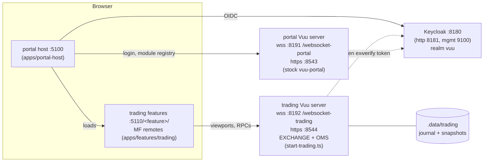
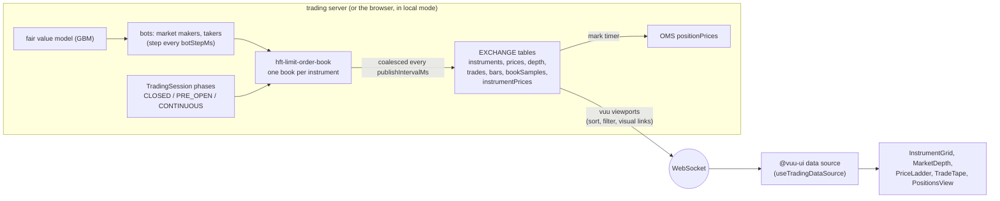
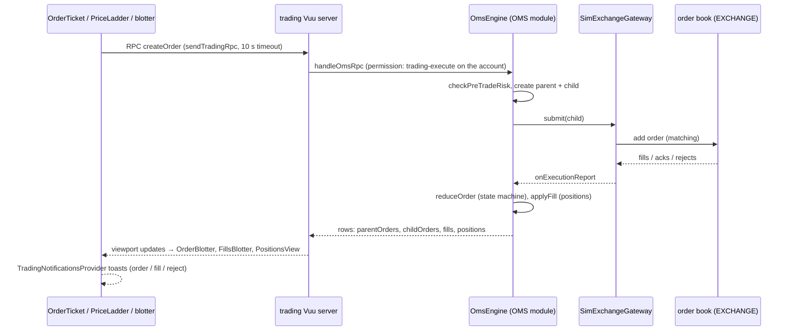
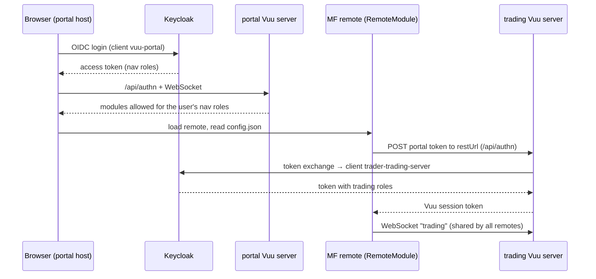
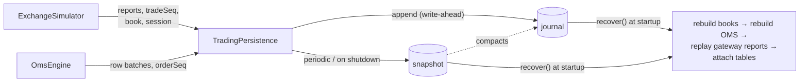
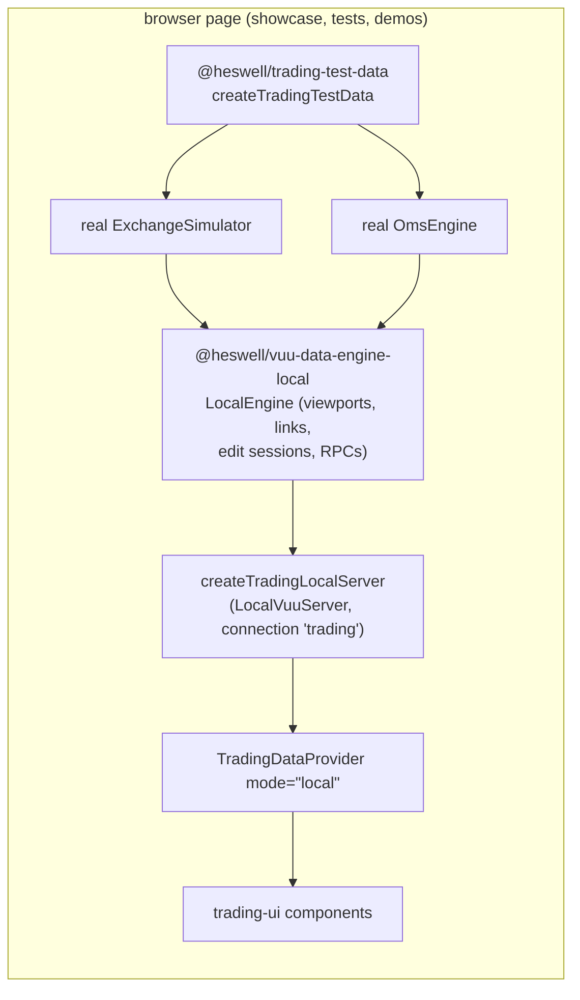
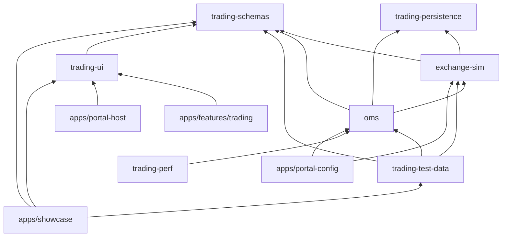

# Architecture

trader's main deliverable is a **reusable trading front-end**: `@heswell/trading-ui` components, hooks and
features built on `@vuu-ui/*` 4.0.0-alpha.31 and vuu-portal. Everything else exists to run that front-end against
realistic data:

- an exchange simulator;
- an OMS;
- persistence;
- Keycloak auth;
- an in-browser engine for server-free demos and tests.

This page is the map. For details, follow the links. The index of all docs is [docs/README.md](README.md).

- [1. Processes and ports](#1-processes-and-ports)
- [2. Market data flow](#2-market-data-flow)
- [3. Order flow](#3-order-flow)
- [4. Authentication and permissions](#4-authentication-and-permissions)
- [5. Persistence and recovery](#5-persistence-and-recovery)
- [6. Engine-local mode](#6-engine-local-mode)
- [7. Package map](#7-package-map)
- [8. Design decisions and trade-offs](#8-design-decisions-and-trade-offs)

## 1. Processes and ports

`bun run start:all` starts the whole stack. It reports busy ports and never takes them over, and every port has a
`TRADER_*` variable ([operations.md](operations.md#ports-and-urls)).

| Process | Default address | Source |
| --- | --- | --- |
| Keycloak (realm `vuu`) | `https://localhost:8180` | `scripts/stack/keycloak-realm.ts`, `infra/keycloak/realm-vuu.json` |
| portal Vuu server (auth + module registry) | `wss://localhost:8191/websocket-portal`, `https://localhost:8543` | `apps/portal-config/application.conf` |
| trading Vuu server (EXCHANGE + OMS) | `wss://localhost:8192/websocket-trading`, `https://localhost:8544` | `apps/portal-config/application.trading.conf`, `apps/portal-config/src/start-trading.ts` |
| portal host (PortalShell) | `http://localhost:5100` | `apps/portal-host` |
| features server (MF remotes) | `http://localhost:5110/<feature>/` | `apps/features/trading`, `scripts/stack/serve.ts` |
| showcase (dev only) | `http://localhost:5001` | `apps/showcase` |
| stand-alone EXCHANGE + OMS (dev only) | `ws://localhost:8095/websocket-trading`, `http://localhost:8447` | `packages/oms` (`start`) |
| stand-alone exchange-sim (dev only) | `ws://localhost:8094/websocket-exchange-sim` | `packages/exchange-sim` (`start`) |

There are **two Vuu servers**:

- The portal server only authenticates users and serves the module registry.
- The trading tables run in a separate trading server. Each remote's `config.json` points at it, and
  `RemoteModule` opens one shared connection named `trading` for all of them.
- See [portal-integration.md](portal-integration.md#two-vuu-servers).

## 2. Market data flow

1. `ExchangeSimulator` (`packages/exchange-sim`) holds one hft-limit-order-book 2.0 book per active instrument.
   Market-maker and taker bots trade around a GBM fair value. A `TradingSession` schedule can drive phases.
   See [exchange-sim: market model](../packages/exchange-sim/README.md#market-model).
2. Book changes are coalesced. Every `publishIntervalMs` (100 ms), each changed book writes one row to the
   `EXCHANGE` tables. The table schemas are defined once in `@heswell/trading-schemas` ([schemas.md](schemas.md)).
3. vuu-server serves those tables as viewports, so sorting, filtering, grouping and visual links run server-side.
   Only the visible rows go over the WebSocket.
4. In the browser, trading-ui hooks open the data sources against the connection that `TradingDataProvider` (or
   the portal's `RemoteModule`) supplies:
   - `useTradingDataSource`;
   - `useTradingRows`;
   - `useMarketData`.
5. The components render the rows:
   - grids use vuu-ui `Table`;
   - the ladder and depth views use their own row hooks.

   Per-table detail is in each component's guide ([components](components/README.md)).

Instrument linking between panels happens on the client, through an in-page bus plus a `BroadcastChannel`, not
through the server ([selection and linking](components/selection-and-linking.md)).

## 3. Order flow

- Order entry is a **direct RPC**. The order RPCs (`createOrder`, `amendOrder`, `cancelOrder`, `cancelAll`) are
  defined in `@heswell/trading-schemas`. The reasons for this choice are in
  [protocol-parity.md](protocol-parity.md#3-order-entry-recommendation-direct-rpc).
- Inline amend and cancel in the blotter go through a vuu **edit session** on `parentOrders`. The OMS turns
  edits into amend and cancel requests ([OMS: edit session](../packages/oms/README.md#blotter-inline-edit-edit-session)).
- Parent and child orders are 1:1 today. The OMS splits the route into a child order that is sent to the
  exchange through the in-process gateway ([OMS README](../packages/oms/README.md)).
- Every state change is a legal transition of `ORDER_STATUS_TRANSITIONS`. Fills update positions, and the mark
  timer reprices them into `positionPrices`.
- Errors come back as `CODE: message`, e.g. `PRICE_OUTSIDE_COLLAR`. The UI shows them in the ticket and as
  notifications ([order ticket](components/order-ticket.md), [notifications](components/notifications-and-connection.md)).
- The OMS also generates background order flow ("other traders") for accounts in `OMS_FLOW_ACCOUNTS`.

## 4. Authentication and permissions

There are two layers of roles:

- **Navigation roles** come from the portal token and decide which features a user sees:
  - `trading-access`;
  - `trading-execute-access`;
  - `trading-supervisor-access`.
- **Trading roles** live on the trading server's own client and decide what the server allows:
  - `trading-view`;
  - `trading-execute`;
  - `trading-supervisor`.

The server is authoritative:

- The OMS filters OMS rows per user and account.
- RPCs and edits need `trading-execute` on the account.

The UI only mirrors those rules. It hides or disables entry points (`readOnly`, `launchOrderTicket`), and the
portal gates whole modules by role. See [components: permissions](components/README.md#permissions),
[OMS permissions](../packages/oms/README.md#permissions) and
[users and roles](portal-integration.md#users-and-roles).

| User (password `password`) | Roles |
| --- | --- |
| alice, bob, carol, erin | view + execute |
| dave | view only |
| sam | view + supervisor |
| admin | view + supervisor + portal module admin |

## 5. Persistence and recovery

- **Store.** `start:all` keeps the trading server's state in a **file** store under `.data/trading`. The default
  elsewhere is `memory`, and `sqlite` is also available.
- **Write-ahead.** Each journal entry reaches the OS before any client can see the change it records.
- **Snapshots.** A snapshot compacts the journal.
- **Recovery** runs at startup, before the tables attach. It restores the books (customer orders, keeping queue
  priority) and the OMS rows, then replays the gateway reports. Bot liquidity is not persisted; the bots re-quote
  around the restored price.
- **Reset.** Clear the state with `bun run persistence:reset` or `TRADER_PERSISTENCE_RESET=1`.

See [persistence.md](persistence.md).

On the client side, [resilience.md](resilience.md) covers the rest:

- a reconnect supervisor with backoff, re-login and resubscribe;
- stale-data indicators;
- RPCs that are blocked while disconnected.

## 6. Engine-local mode

`@heswell/trading-test-data` runs the **real** exchange-sim and OMS engines in the page, on engine-local 4.2. The
components therefore see the same table schemas, RPC handlers, validation errors and per-user filtering
(`setCurrentUser`) as they do against the server, with no network at all. This mode powers:

- the [showcase](../apps/showcase/README.md);
- `test:ui`;
- the getting-started example ([engine-local mode](getting-started.md#2-engine-local-mode-no-servers)).

It is a dev and test dependency. Reusable code must never import it.

## 7. Package map

| Package | Responsibility | Depends on (besides `@vuu-ui/*`) |
| --- | --- | --- |
| `@heswell/trading-schemas` ([README](../packages/trading-schemas/README.md), [API](api/trading-schemas.md)) | Table definitions, enums, order status transitions, RPC contracts, tick and lot utils, shared by server and UI | `@heswell/vuu-server` (types) |
| `@heswell/trading-persistence` ([persistence.md](persistence.md)) | memory / file / sqlite journal and snapshot stores | none |
| `@heswell/exchange-sim` ([README](../packages/exchange-sim/README.md)) | Order books, bots, trading session, EXCHANGE module, admin RPCs, in-process gateway | schemas, persistence, `@heswell/hft-limit-order-book`, `@heswell/vuu-server` |
| `@heswell/oms` ([README](../packages/oms/README.md)) | OMS module: risk, routing, state machine, positions, background flow, permissions, `TradingPersistence` | exchange-sim, schemas, persistence, `@heswell/vuu-server` |
| `@heswell/trading-ui` ([guides](components/README.md), [API](api/trading-ui.md)) | **The reusable front-end**: components, data hooks, linking, notifications, resilience, hosting | schemas |
| `@heswell/trading-test-data` ([README](../packages/trading-test-data/README.md), [API](api/trading-test-data.md)) | Server-free EXCHANGE + OMS on engine-local | exchange-sim, oms, schemas, `@heswell/vuu-data-engine-local` |
| `@heswell/trading-perf` ([performance.md](performance.md)) | `perf:ws`, `perf:ui` and `perf:ladder` tools | oms |
| `apps/features/trading` ([ui-guide §10](ui-guide.md#10-packaging-a-component-as-an-mf-feature-appsfeaturestrading)) | Portal features: one MF remote per entry of `catalog.ts` | trading-ui |
| `apps/portal-host` ([portal-integration.md](portal-integration.md)) | PortalShell host: Keycloak login, navigation | trading-ui |
| `apps/portal-config` ([portal-integration.md](portal-integration.md#running)) | Portal and trading server confs, `start-trading.ts`, generated module lists | exchange-sim, oms, `@heswell/vuu-portal`, `@heswell/vuu-server` |
| `apps/showcase` ([README](../apps/showcase/README.md)) | Example of every reusable component, on local or remote data | trading-ui, trading-test-data, schemas |

## 8. Design decisions and trade-offs

**Reusable UI first.**
- `trading-ui` depends only on `@heswell/trading-schemas` and `@vuu-ui/*`. It never imports server or test-data
  code.
- Components take their data connection from context, so the same component runs in a portal feature, a
  stand-alone app or the showcase.
- The cost: hosts must provide `TradingDataProvider` or `TradingFeatureRoot` ([hosting](components/hosting.md)).

**Schemas defined once.**
- Table columns, keys, enums and RPC contracts live in `trading-schemas` and are used by both the server and the
  UI, so the two cannot drift.
- The cost: the schema package depends on vuu-server types.

**Real engines in the browser instead of fake data.**
- Local mode runs the real exchange-sim and OMS, so demos and UI tests use the real behaviour, including
  validation errors and order state transitions.
- The cost: a bigger showcase bundle, and these engines must stay browser-safe (no Node APIs in the core).

**Two Vuu servers.**
- The portal server stays stock, and the trading server can be moved, restarted or scaled on its own (see
  `TRADER_TRADING_*`).
- The cost:
  - an extra process and port pair;
  - a token exchange (Keycloak 26 standard token exchange) on every remote login;
  - an upstream dependency on `config.json` handling (trader upstream issue 57).

**Direct RPC for orders, edit session for blotter amends.**
- RPCs give a synchronous accept or reject per order.
- The edit session reuses vuu-ui's inline table editing.
- See [protocol-parity.md](protocol-parity.md).

**Server-side permissions.**
- The UI gating is a usability layer only.
- The OMS filters rows and checks every RPC and edit, so a modified client cannot see or trade other accounts.

**Coalesced publishing.**
- The exchange publishes at most once per `publishIntervalMs` per book, and the UI batches flashes and sparklines.
- This trades a little latency for bounded CPU at high bot rates ([performance.md](performance.md)).

**Write-ahead journal plus snapshots.**
- Synchronous appends keep recovery exact. They cost some throughput, which `fsync` and the snapshot interval
  can tune.
- Bot orders are not persisted, so the books recover only with customer orders.

**Upstream first.**
- Gaps in `@vuu-ui/*`, vuu-server and vuu-portal are worked around locally and recorded in
  [upstream-issues.md](upstream-issues.md) as "trader upstream issue N".
