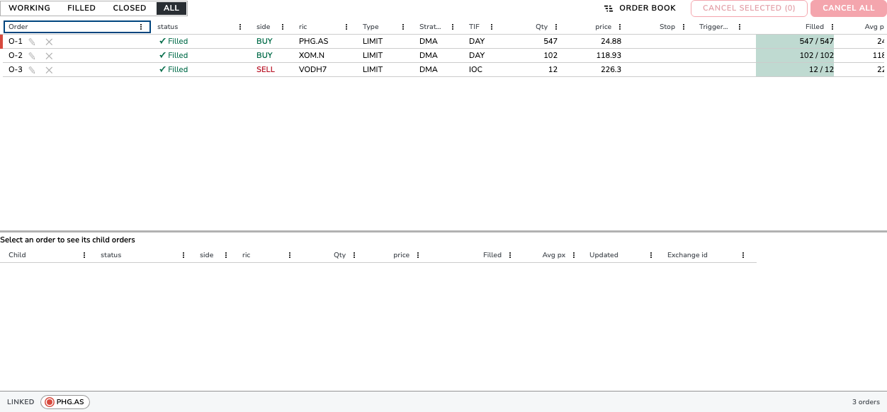
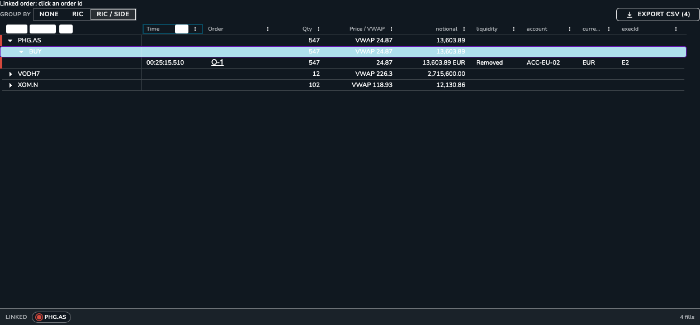

# Blotters, tape and positions

Reference: [OrderBlotter](../api/trading-ui.md#orderblotter), [FillsBlotter](../api/trading-ui.md#fillsblotter),
[TradeTape](../api/trading-ui.md#tradetape), [PositionsView](../api/trading-ui.md#positionsview).

Showcase: `#order-blotter`, `#fills-blotter`, `#trade-tape`, `#positions-view`, all four in `#trader-workspace`.




| Component | Tables | RPCs | Roles |
| --- | --- | --- | --- |
| `OrderBlotter` | `parentOrders`, `childOrders` (selected order) | `cancelOrder`, `cancelAll`, `amendOrder`, or a `parentOrders` edit session with `useEditSession` | `readOnly` hides amend / cancel; pass `readOnly={!canTrade}` for users without `trading-execute` |
| `FillsBlotter` | `fills` | – | view only |
| `TradeTape` | `trades` | – | view only |
| `PositionsView` | `positionPrices` | – | view only |

Rows are filtered by the OMS per user (see [permissions](README.md#permissions)), so a supervisor sees every
account on their desks with the same component.

All four wrap themselves in `InstrumentLookupProvider` (one `instruments` subscription, reused if nested).
`TradeTape` and `PositionsView` take `LinkGroupProps` (`linkGroup`, `defaultLinkGroup`, `showLinkGroupSelector`,
`onLinkGroupChange`); the tape follows its group. `OrderBlotter` and `FillsBlotter` have no link group: row
selection stays local and publishes nothing, as channels are driven from the watchlist / instrument grid.

## Channels in the Orders and Fills blotters

The two blotters show the workspace channels without following one:

- **Row markers.** A row whose RIC is on a channel shows a 4px marker in that channel's colour at its left end
  (the vuu Table row bookend). A selected row shows vuu's normal bordered selection instead. Use
  `useChannelRowMarkers(tableConfig)` to do the same in another table: it returns a stable `tableConfig` with a
  row class generator, plus a `colorStyle` element to render beside the table.
- **Linked footer.** `LinkedInstrumentsFooter` lists one chip per instrument on a channel. Pressing a chip
  filters the blotter to that RIC (pressed chips show ×); pressing it again, or the RIC leaving its channel,
  clears the filter. The footer also shows the row count (`12 orders`, `3 fills`).
- **Link from a row.** The only way to publish from a blotter is the row context menu's **Link <RIC> to ▸**,
  which lists each channel with what it holds now (`Red · VOD.L`, `Green · BARC.L ✓`, `Blue · empty`).
  Choosing one moves the RIC there (an instrument is on one channel at most). Orders rows also offer
  **Amend…**, **Cancel order** and **Order book** where they apply; Fills group rows have no menu. The menu
  helpers are exported as `channelLinkMenuItem` and `handleChannelLinkAction`.

| Component | Props |
| --- | --- |
| `OrderBlotter` | `defaultTab` (`working` \| `filled` \| `closed` \| `all`), `showChildOrders` (default true), `onOrderSelect(orderId?, ric?)`, `onError(TradingRpcError)`, `notify` (default true: failed amend / cancel requests also go to `useTradingNotifications()` when a provider is mounted), `readOnly` (default false: hide the amend / cancel controls), `useEditSession` (amend through the server edit session instead of `amendOrder`: the dialog begins the session when it opens, Amend saves it, Close discards it, and an order that changed meanwhile is refused as stale). Tabs filter client side on `status`. Amend / cancel icons are enabled only for NEW, PARTIALLY_FILLED, REPLACED. Multi-select (ctrl / shift click) + **Cancel selected** sends `cancelOrder` per order; **Cancel all** asks first (a prompt with the count of the user's working orders, in every instrument, and a per-RIC list; focus starts on **Keep orders**), then sends `cancelAll`. Amend opens a dialog (quantity, price for priced orders, and stop price for a STOP / STOP_LIMIT that hasn't triggered; only a changed stop price is sent, as `stopPrice` in `amendOrder` or a `stopPrice` editCell in the edit session). Stop orders show their **Stop** price (blank for other types) and **Triggered**: "Waiting" until the stop triggers, then the trigger time (`triggeredAt`). Child orders of the selected order show in a pane below, in a `SplitPane` the user can drag (a vuu LinkedTableView / tree does not span tables, still the case in alpha.21). Rejected rows show `rejectReason: text` as a tooltip on the status. **Order book** (`showOrderBook`, default true) opens the selected order's book in the shell's context panel, or in a dialog outside a portal shell; the panel follows the selection (see [Order book panel](#order-book-panel)). |
| `FillsBlotter` | `defaultGrouping` (`none` \| `ric` \| `ric-side`), `ric`, `onOrderSelect(orderId)` (order link), `highlightOrderId`, `csvFileName`. Group rows show summed quantity / notional and VWAP (`sum(notional) / sum(quantity)`, computed in the renderer – vuu has no VWAP aggregation). **Export CSV** writes the current filter and sort, ungrouped, up to 5,000 rows. |
| `TradeTape` | `ric` (default: selected instrument), `maxRows` (100), `largeSizeThreshold` (absolute) or `largeSizePercentile` (90), `utc`. Newest first (`seq` descending), one render per animation frame, aggressor shown as ▲ Buy / ▼ Sell plus colour. |
| `PositionsView` | `defaultGrouping` (`sector` (default) \| `none` \| `account` \| `ric` \| `underlying`, which puts a stock or index with its futures and options; groups are always by currency first), `account`, `showTotals`. Realised / unrealised / total P&L tick via `positionPrices`. `sector` and `exchange` come from instrument static (the OMS copies them onto `positions`). The totals table is **per currency** (never mixed; GBX is pence). Greeks: `delta` (shares equivalent), `deltaUsd`, `gamma`, `vegaUsd`, summed in groups ([options.md](options.md#greeks-in-positions)). |

```tsx
const { canTrade } = useEntitlements(); // your app's role check
<OrderBlotter readOnly={!canTrade} useEditSession />
<FillsBlotter defaultGrouping="ric" onOrderSelect={setOrderId} />
<PositionsView defaultGrouping="account" />
```

The RPC contracts and error reasons (`TOO_LATE_TO_CANCEL`, `ORDER_PENDING`, ...) are in
[packages/oms/README.md](../../packages/oms/README.md#rpcs); the edit session in
[Blotter inline edit](../../packages/oms/README.md#blotter-inline-edit-edit-session).

## Order book panel

`OrderBookView` (`orderId`, `levels` (default 10), `level` / `onLevelChange`) shows the book a parent order is
working in, read top down:

1. **Order**: side, quantity, instrument, type (`Lmt 99.40`, `Stp 99.50`, `Stp 99.50 Lmt 99.40`, with "waiting" /
   "triggered" for stops) / strategy / TIF, and a bar of filled, resting and not yet sent.
   Below it, one chip per working child order that is in the book, with its queue position (`#4 of 9 · 6,300
   ahead`).
2. **Level 2**: the instrument's `depth` levels, asks above bids. A dot marks the levels holding the order, and
   each row ends in a strip of the L3 queue (one segment per resting order, the order's own in the
   `--trading-own-order` colour).
3. **Level 3**: the queue at the selected level from `bookOrders`, front first: a proportional bar, the
   order's position / size ahead / behind / size, and the orders (exchange id, size, size ahead, age), the
   order's own labelled with its child order id.

It opens on the level of the best-placed working child order, else the best price on the order's side. Click a
level or a child order chip to see that queue; a picked level stays put as the book moves until **Reset level**
(beside the Level 2 heading) returns to the default level and `onLevelChange(undefined)` is called. Data comes from `useOrderBook(orderId)`: the parent order, its
`childOrders`, `useMarketDepth` and `useBookQueue` with the working child orders' exchange ids. When
`bookOrders` is empty but `depth` is not, the server has L3 off and the panel says so; when an instrument has
more resting orders than `useBookQueue` loads (`truncated`), it says the queues may be incomplete.

In a vuu context panel, the panel widens to `min(480px, 90vw)` while it shows an order book (vuu's default is
300px). Set `--tradingOrderBookView-panelWidth` (for example on `:root`) to choose another width.

The layout holds still while the book ticks: each side of the depth always takes `levels` rows (blank rows pad the
asks above and the bids below), the child order chips sit in one fixed-height row that scrolls sideways, and the
queue table has fixed column widths.

The blotter renders the panel content inside its own React tree (`SlotContextPanelProvider` portals it into the
shell's panel), so the content sees the blotter's data providers and follows its selection without being
reopened.

## Trades

`TradesView` (the **Trades** panel, Market › Trades) is every trade on the `trades` table in a vuu Table:
newest first, sortable by any column, and scoped to **All instruments** or the linked instrument (a toggle
labelled with its RIC). The footer counts the trades in scope; **Export CSV** writes all of them in the current
scope and sort.

Props: `defaultScope` (`all` \| `linked`), `linkGroup` / `defaultLinkGroup` / `onLinkGroupChange`,
`showLinkGroupSelector`, `csvFileName`. Its table config is exported as `tradesViewTableConfig`.

The table is a ring buffer of `exchangeSim.tradesCapacity` rows (50k by default). To demo export at size, start
the trading server with `exchangeSim.tradesSeed=1000000` (`EXCHANGE_SIM_TRADES_SEED`, or
`bun run dev:trading-server:1m`): it starts with a million historical trades and ticks on top.

## Export CSV

`ExportCsvButton` exports every row of a panel's Table (not just the rows on screen) in its current filter and
sort, formatted the way the grid shows it. It streams, so it works at a million rows: see
[viewport-export.md](../viewport-export.md) for the design and measurements.

```tsx
<ExportCsvButton
  dataSource={dataSource}   // the Table's data source: its filter and sort
  fileName="fills.csv"      // suggested name in the save dialog
  table="fills"             // the trading table it is on
  tableConfig={tableConfig} // the Table's config: visible columns, order, labels, formats
  textFormatters={{ [MY_RENDERER]: (value, row) => "..." }} // the panel's own cell renderers
/>
```

- **Columns.** The table config's visible columns, in order, headed by their labels. Each value goes through a text
  formatter for its cell renderer (the trading renderers have them: `tradingTextFormatters`; pass
  `textFormatters` for a panel's own), else vuu's value formatter, as the default cell renderer.
- **Rows.** Remote: the server snapshots the viewport and streams it over HTTP (`EXPORT_VIEWPORT`). Local test
  data: the in-browser engine's viewport is snapshot in the page.
- **Grouped data sources** export their leaf rows: the button opens a temporary ungrouped viewport with the same
  columns, filter and sort, and closes it when done.
- **Destination.** Chromium on HTTPS or localhost: a file the user picks, written as rows arrive. Elsewhere: built in
  memory, then downloaded.
- **While it runs** the button turns into Cancel, with a percentage beside it. The result stays for a few
  seconds: rows and time, with size, snapshot time and throughput on hover.

`useViewportExport` is the same without the button: `{ status, exportCsv, cancel, reset }`.

## CSS hooks

Class bases `tradingOrderBlotter`, `tradingFillsBlotter`, `tradingTradesView` (`data-scope`), `tradingExportCsvButton` (`-status`, with `data-state`), `tradingTradeTape`, `tradingPositionsView`,
`tradingLinkedFooter` (chips: `-chip`, with `data-active` when pressed). Rows on a channel carry
`tradingChannelRow tradingChannelRow-<channel id>`, which sets `--tradingChannelRow-color`. Useful
attributes: `data-link-group` (TradeTape, PositionsView), `data-testid`, `data-connection-state` / `data-error` (OrderBlotter),
`data-aggressor` / `data-large` (TradeTape), `data-currency` (PositionsView). The full list is in the
[catalogue](../api/components.md#css-hooks).

## Shared pieces

All exported:

- `OrderStatusBadge`, `FillProgressBar`, `PnlValue` (see [primitives.md](primitives.md)).
- Cell renderers registered by `registerTradingCellRenderers()` and named in `TradingRenderer` (`trading.order-status`,
  `trading.side`, `trading.fill-progress`, `trading.price`, `trading.pnl`, `trading.position-quantity`,
  `trading.notional`, `trading.time`, `trading.liquidity`, `trading.stop-trigger`). Use them as a column
  `type: { name: "string", renderer: { name } }`.
- `useInstrumentLookup`, `useDataSourceRows` (rAF-coalesced rows from a data source you own), `useTableSelectedKeys`,
  `editOrdersInSession` / `openOrderEditSession` (`StaleOrderEditError` on a stale save).
- `formatTime`, `rowsToCsv` / `downloadCsv` and the order status helpers (`isOrderAmendable`, `WORKING_STATUSES`,
  `stopTriggerState`, ...).
