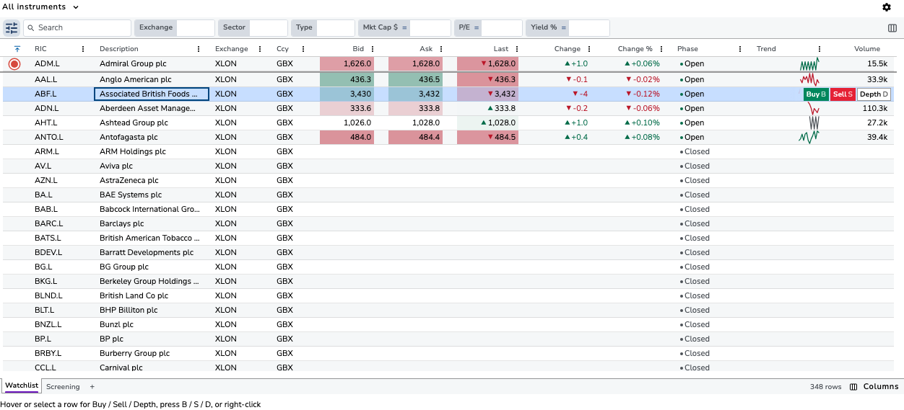
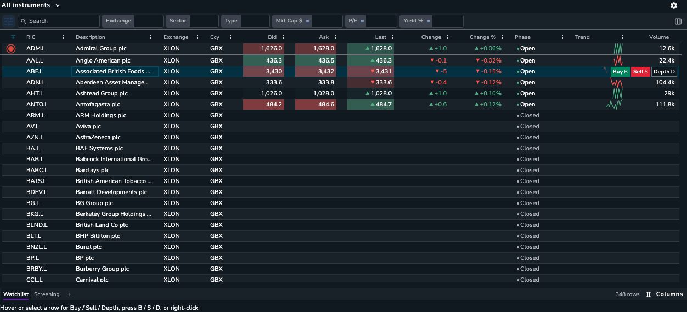

# InstrumentGrid (P3.2), Sparkline (P3.3) and the grid cell renderers

Reference (props, types, defaults): [InstrumentGrid](../api/trading-ui.md#instrumentgrid),
[Sparkline](../api/trading-ui.md#sparkline), [SparklineCell](../api/trading-ui.md#sparklinecell),
[PriceMoveCell](../api/trading-ui.md#pricemovecell), [ChangeCell](../api/trading-ui.md#changecell),
[QuantityCell](../api/trading-ui.md#quantitycell), [PhaseCell](../api/trading-ui.md#phasecell).

Showcase: `#instrument-grid`, `#instrument-grid-prices`, `#instrument-grid-futures`, `#instrument-grid-continuations`, `#instrument-grid-200` (perf), `#primitives-cell-renderers`
(the renderers in a plain vuu `Table`), `#hosting-user-settings` (watchlist storage).

| | |
| --- | --- |
| Tables | `instrumentPrices` (default) or `prices`; `instruments` through `InstrumentLookupProvider` |
| RPCs | none itself. Buy / Sell open the order ticket, which sends `createOrder`. |
| Roles | none in the component. Pass `launchOrderTicket={canTrade}` to hide Buy / Sell for view-only users (as the Watchlist feature does). |
| Class base | `tradingInstrumentGrid`, cells `tradingInstrumentCell`, link cell `tradingLinkCell`; `data-direction`, `data-phase` |




ADM.L linked to Red and pinned above the other rows; ABF.L selected, with its Buy / Sell / Depth. Regenerate with
`bun ./scripts/docs/screenshots-instrument-grid.ts` while the showcase runs.

## InstrumentGrid

A preset over the vuu `Table` bound to `instrumentPrices` (or `prices`: columns that do not exist are dropped).

```tsx
<InstrumentGrid onBuy={(i) => ...} onSell={(i) => ...} onOpenDepth={(i) => ...} />
```

| Prop | Meaning |
| --- | --- |
| `dataSource?` / `table?` | Supply a data source, or bind `"instrumentPrices"` (default) / `"prices"`. |
| `columns?` | Visible column names in order (default: ric, description, exchange, currency, bid, ask, last, change, changePct, phase, sparkline, volume, turnover). The "Columns" button opens the vuu column picker; the header menu gives sort / group / hide. Headers are Title Case labels (RIC, Mkt Cap $); a column with no preset gets its name in Title Case (`titleCaseColumnName`: "bidSize" → "Bid Size"). |
| `simulatedOnly?` | Default false. True: only instruments quoted by the simulator (instrumentPrices). Unquoted instruments show empty price cells. |
| `instrumentType?` | `EQUITY` / `FUTURE` / `INDEX` / `CONTINUATION`: only that type. Otherwise, when the data has an `instrumentType` column, type is a quick filter in the filter bar. |
| `initialGroupBy?` | `exchange` / `sector` / `currency` / `instrumentType` / `underlying` (a stock or index with its futures); volume and turnover are summed in group rows. It sets the first grouping only: after that, group from the column header menu (the grid has no group-by control). |
| `sparkline?` | `false` or `{ valueColumn, length, bucketMs }`. |
| `id?` | Keys the saved column sets, filters and panel settings, so differently configured grids keep their own. |
| `showToolbar?` | Default true. False hides the panel header (scope picker, panel settings) and the filter bar. (The grid has no toolbar row any more; the name is kept for compatibility.) |
| `showFooter?` | Default true: the grid offers a footer (see [Footer](#footer)), shown or hidden from Panel settings. False removes it and its menu item. |
| `onBuy` / `onSell` / `onOpenDepth` | `(instrument: SelectedInstrument) => void`. The row actions, B / S / D keys and context-menu items exist only when the prop is set, or (Buy / Sell) when an `OrderTicketLauncherProvider` is mounted. The menu items are client-side and call direct RPCs; vuu-server 3.3.0 supports server menu RPCs, but trader declares none (trader upstream issues 11 and 63–66 in [upstream-issues.md](../upstream-issues.md)). |
| `launchOrderTicket?` | Default `true`: without `onBuy` / `onSell`, Buy / Sell open the ticket via `useOrderTicketLauncher()` when a launcher is present. |
| `watchlistStorage?` | `UserSettingsStorage` override for the watchlists. |

## Panel header

- **Scope picker** (the title): All instruments or a watchlist, with its count. The same menu adds or removes the selected row's ric on the current watchlist, creates a watchlist (in the `WatchlistDialog`, then shown) and deletes the current one.
- **Panel settings** (cog): Show filter bar (Ctrl+Shift+F anywhere in the grid), Show footer and Pin linked rows to the top. Saved per grid `id` under `trading.instrumentGrid.view`.
- **Filter badge**: while the filter bar is hidden its filters still apply, and the header shows a badge with the clause count; clicking it shows the bar.

In a `@vuu-ui/grid-layout` panel these go into the panel's own header: the scope picker as the title (at the start of the tab bar when the panel is stacked), the badge and gear at the end. Anywhere else the grid shows them in a header row of its own.

## Channel links

The grid is not in a link group. Its first column (`link`, client-side, outside column sets and the column picker) links rows to the workspace channels set by the ChannelPicker; with no `WorkspaceChannelProvider` it uses the default channels with Red active.

- A row whose instrument a channel holds shows that channel's dot, ringed when it is the active channel. An unlinked row shows a link glyph on hover or focus.
- Clicking the cell opens the link menu: each channel with what it holds ("replaces X", "empty", or "Linked · click to clear"). The heading is "Link RIC to channel", or "Move RIC from Green to" when the instrument is already linked.
- One channel per instrument (`linkInstrument`): linking to another channel moves it and empties the old one. The ChannelPicker follows the same rule.
- Keys on the focused row: Enter links to the active channel, 1–4 to Red, Green, Blue, Yellow, L opens the menu, Esc closes it. Double-click a row to link it to the active channel.
- **Pinned linked rows**: linked rows are pinned above the scrolling rows, in channel order, by default. The link column header (pin icon) and Panel settings turn this off and on. The grid passes the linked rics to the vuu Table's `pinnedRows` (since vuu-ui 5.0.0-alpha.8), which subscribes to them separately and leaves them out of the body. Pinned rows ignore the grid's filters (fixed type, watchlist, filter bar) on purpose: a linked instrument is always in view. They follow the body's sort and columns and are never grouped. Arrow keys move across the divider, and the footer row count is for the body only.
- Row selection is local to the grid (row actions, watchlist add / remove): only an explicit link publishes, with source `"InstrumentGrid"`.

Design spec: [docs/design/instrument-grid](../design/instrument-grid/README.md).

## Row actions

Buy, Sell and Depth sit at the right edge of a row, in a narrow client-side column (`actions`, pinned right, outside column sets and the column picker) whose buttons overflow leftwards over the last cells. They show on one row at a time: the hovered row, else the keyboard-highlighted row, else the selected (or focused) row. They fade in over the cells below them.

- Keys on the focused row: **B** Buy, **S** Sell, **D** Depth.
- The context menu has the same three items, labelled with their keys.
- Buy / Sell through the launcher fill a docked order ticket and move focus to its quantity field; the new instrument and side replace anything typed but not sent.
- Each one is shown only when its handler exists (`onBuy` / `onSell` / `onOpenDepth`, or Buy / Sell from an `OrderTicketLauncherProvider`). With none, there is no actions column.
- Buy / Sell use the order ticket's side colours (`--trading-buy`, `--trading-sell`, over Salt's positive / negative bold actionable colours).

## Footer

One 22px row under the table (linked instruments show in the link column and the workspace ChannelPicker, so the footer does not repeat them):

- **Column-set tabs** on the left, text tabs; the active one is on the grid's surface (`--salt-container-primary-background`), moved up 1px over the footer's top border with that border down its sides and along its bottom, so the line runs along the footer and round the tab (no indicator bar); other tabs show a neutral underline on hover: click, or Left / Right arrows on a focused tab, to show a set. "+" saves the columns in view as a new set, named in a `NamePrompt` (see [Dialogs](#dialogs)).
- **Row count**: the rows in the body, "N rows", kept current from the data source's `resize` events. Under a filter-bar filter it is the filtered count, bold with a filter icon; the server sends no unfiltered total, so it is never "x of y". Pinned rows are not counted.
- **Columns** on the right opens the vuu column picker.


## Dialogs

The grid never uses browser prompts. Naming (a new watchlist, a new column set) uses `NamePrompt`: a vuu `Prompt` (Salt Dialog) with one Salt Input, focused and selected on open. Enter or Create confirms; `validate` returns an error shown under the field, and while there is one Create is disabled. New watchlist opens `WatchlistDialog`: a name, a search by RIC or name, Sector / Type / Exchange / Currency filters (Salt multiselect dropdowns; options from vuu's `getUniqueFieldValues`, Type from the enum), the matches (up to 500, from `instruments`) and the picked list beside them. While a search or filter narrows the list, **Add N matches** adds every match not yet picked. Keys: ↑↓ move, Enter adds or removes, Alt+A adds matches, Ctrl+Enter saves. Deleting a watchlist asks in a warning `Prompt`, Cancel focused. Showcase: `#instrument-grid-dialogs`.

## Rows

Faint row dividers (vuu's `rowSeparators`, at half the tertiary separator colour) and subtle zebra stripes (`zebraStripes`, Salt's secondary container colour). The row actions' fade follows the stripe.

## Quick filter suggestions

The quick filters' typeahead asks the server for a column's values (`getUniqueFieldValuesStartingWith`) through the data source of vuu-utils' `DataSourceProvider`; the grid wraps its FilterBar in one with its own data source. Matching is case sensitive, as the server's `startsWith` is (compare trader upstream issue 113): "M" suggests Materials, "m" nothing.

## Light and dark

Both themes use vuu-theme / Salt variables only; the dark design boards are in
[docs/design/instrument-grid](../design/instrument-grid/README.md).

- In dark mode the grid sets vuu's per-table row hooks (`--vuuTableRow-background-selected`,
  `--vuuTableRow-bookend-background-selected`, `--vuuTableRow-background-highlighted`) to dark tones: vuu-theme's
  dark selected and hover rows are light teal under white text (upstream issue 115). Menus, outside the grid, are not
  patched.
- Buy / Sell take Salt's bold positive / negative colours, or a host's `--trading-buy` / `--trading-sell`; Depth's
  hover is neutral, not the theme's coral.
## Filter bar

The vuu FilterBar sits on its own row and opens on the quick filters:

- **Search** comes first: free text over ric and description (ric only on `prices`). vuu's `contains` is case sensitive, so the grid widens the Search clause to the common casings of the text (`withSearchCasings`, trader upstream issue 113): "bp" finds BP.L.
- **Quick filters**: exchange, sector, type, market cap, P/E and yield by default, where the data has them; the column chooser changes them. Type is left out when `instrumentType` is set.
- **Saved filters**: the toggle switches to the saved filter pills. Its badge counts the applied clauses. Saved filters persist per grid `id` (`trading.instrumentGrid.filters`).

Pure helpers are exported too: `buildInstrumentGridFilter`, `withSearchCasings`, `instrumentGridColumns`, watchlist functions and `useWatchlists`.

**Watchlists and user settings.** Watchlists are client-side lists of rics stored under `trading.watchlists` through a
`UserSettingsStorage` (a `getItem` / `setItem` subset of Web Storage, may be async). The default is localStorage
(memory fallback). In vuu-portal, wrap the feature in `<UserSettingsProvider storage={portalStorage}>` where
`portalStorage` reads / writes the user's settings document in the portal backend; no component changes are needed.
See [hosting.md](hosting.md#usersettingsprovider).

## Cell renderers

Registered when the grid module is imported, or explicitly with `registerInstrumentGridRenderers()`. Use them in any
vuu `Table` column as `type: { name: "number", renderer: { name, componentProps } }` (example:
`apps/showcase/src/examples/PrimitivesExamples.tsx`, showcase `#primitives-cell-renderers`).

| Renderer name | Component | `componentProps` | |
| --- | --- | --- | --- |
| `trading.price-move` | `PriceMoveCell` | `arrow?` | Flash on change, optional up / down arrow (the grid turns it on for `last`). |
| `trading.change` | `ChangeCell` | `percent?` | Sign + arrow + colour. |
| `trading.quantity` | `QuantityCell` | `compact?` | Grouped or compact (1.2M) quantity. |
| `trading.phase` | `PhaseCell` | | Dot + label; HALTED / CLOSED styled. |
| `trading.sparkline` | `SparklineCell` | `valueColumn`, `length`, `bucketMs` | See below. |

Prices are formatted with the row's `priceDecimals` / `tickSize` / `tickBands` when those columns are in the
subscription (they can be hidden). The blotter renderers (`trading.order-status`, `trading.side`, ...) are listed in
[blotters.md](blotters.md#shared-pieces).

## Sparkline

`trading.sparkline` cell renderer (a `source: "client"` column, see `instrumentGridColumn("sparkline")`) or the
presentational `<Sparkline values={[...]} />`. Each visible row keeps a `Float64Array` ring buffer
(`length` samples, 8 bytes each: 40 samples = 320 B per row) in a ref-counted `sparklineStore`; the buffer is freed when the
row's cell unmounts or is recycled (the row leaves the viewport), so only rows in the viewport cost memory, and a row's
history restarts when it comes back. `bucketMs > 0` samples on a constant time axis instead of per change. The polyline is
updated imperatively (no React render per tick). Null values (no trade yet) are not sampled.

*Future:* a server-provided intraday series column (e.g. `last` history as a `string` / array column on `prices`, or an
`intradaySeries` table keyed by ric) could replace the client buffer: the renderer would draw the column value when it
holds a series and fall back to the buffer otherwise, so history would survive scrolling and reloads.

### Performance (headless Chrome, local test data, 1400x900, in-browser exchange + OMS on the same thread)

| Scenario | Frame median / p95 | Main thread busy | Notes |
| --- | --- | --- | --- |
| 50 ticking instruments, 45 rows rendered | 16.7 / 16.8 ms | ~38% (script 25%) | |
| 200 ticking, 45 rows rendered | 16.7 / 16.8 ms | ~54% (script 39%) | 60 fps |
| 200 ticking, all 200 rows rendered (5000px tall) | 50 / 133 ms | ~100% | stress; the plain vuu price-move table at 154 rows was already ~97% busy |

Run it yourself: `?active=200` on the showcase URL, example "InstrumentGrid / 200 ticking rows (perf)". Later
numbers and tooling: [performance.md](../performance.md).
