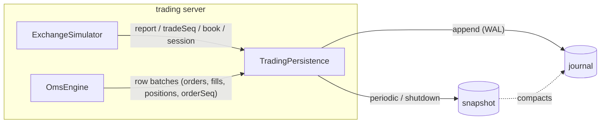

# Persistence: order state survives a trading-server restart

The trading Vuu server (EXCHANGE + OMS) can keep its order state in a durable store and rebuild it at startup.
This covers the exchange books (customer orders), trade ids, the trading-session phase, OMS parent / child orders,
fills, positions and order ids. A restart can be graceful (SIGTERM, Ctrl-C) or a crash (`kill -9`).

- Packages:
  - `@heswell/trading-persistence` ([packages/persistence](../packages/persistence)) holds the stores.
  - `TradingPersistence` ([packages/oms/src/persistence](../packages/oms/src/persistence)) is the coordinator.
  - The export / restore / journal hooks live in `ExchangeSimulator` and `OmsEngine`.
- Default: **memory** (nothing survives the process), so tests and the stand-alone servers are unchanged.
- `bun run start:all` persists to a **file** store in `.data/trading` under the repo root, which is gitignored.

## Design



- **One store, one journal, two streams.**
  - `exchange` entries:
    - every gateway execution report (`report`, written *before* the OMS sees it);
    - trade-id block reservations (`tradeSeq`);
    - admin book changes (`book`: halt / resume / volatility / bot rates);
    - market-phase changes (`session`).
  - `oms` entries are batches of the latest version of every changed row (parents, children, fills keyed by
    `execId`, positions) plus the order-id counter.
  - The OMS hands batches over at the end of the current tick. The coordinator also flushes them before every
    exchange entry, so the journal is in causal order.
- **Write-ahead.** Appends are synchronous. An entry reaches the OS before the change it records is visible to
  any client, so a process crash loses at most work that was never acknowledged.
- **Snapshots.** A snapshot holds:
  - `exchange`: books, trade seq, phase, gateway state;
  - `oms`: all rows and the order seq;
  - the last 2000 gateway `reports`.

  Both sides are snapshotted synchronously in one go, so they are mutually consistent. A snapshot covers every
  entry so far and compacts the journal. Snapshots are written:
  - every `snapshotIntervalMs` (60 s);
  - after `snapshotEveryEntries` (50 000) journal entries;
  - right after a recovery;
  - on graceful shutdown (SIGINT / SIGTERM / `beforeExit`, once).
- **Exchange books.**
  - hft-limit-order-book's `snapshot()` exports each book. Only **customer (gateway) orders** are kept, in time
    priority per level.
  - On restore each book is rebuilt through the `OrderBook({ snapshot })` constructor, so queue priority and book
    seq are preserved.
  - Bot liquidity (market makers, takers) is ephemeral. It re-quotes around the restored fair value; restored
    customer orders keep priority ahead of it.
  - A journal replay of the book would also replay bot orders that no longer exist, so the snapshot is used
    instead.
- **Ids.**
  - Trade ids (`TR<n>`) are reserved in blocks of 1000: a `tradeSeq` entry is journaled before a block is used.
    After a crash the counter resumes at the end of the last reserved block, so trade ids may jump but are
    never reused. After a graceful shutdown they continue exactly.
  - Exchange order ids and OMS order / child / exec ids are restored from their counters.

### Recovery (`TradingPersistence.recover`, at startup before tables attach)

1. Load the latest snapshot and the journal after it. A torn last journal line (crash mid-write) is dropped with
   a warning.
2. Rebuild the exchange. Restore the snapshot state, then apply the journaled `tradeSeq` / `book` / `session`
   entries and the `report` entries:
   - a fill reduces or removes the resting order;
   - a cancel / expire removes it;
   - an ack of a new order or replace adds or moves it.
3. Rebuild the OMS: snapshot rows plus the journaled row batches, last write wins.
4. **Replay gateway reports into the OMS.** `OmsEngine.applyExecutionReport` uses the snapshot's recent reports
   plus the journaled ones. Each child skips reports it has already applied (`exec seq <= lastExecSeq`). This
   repairs a crash *between the exchange fill and the OMS update*: the report is in the journal, the OMS change
   is not, so the fill, order status and position are applied now, exactly once.
5. **Reconcile** (`OmsEngine.reconcile`) the OMS against the exchange. Every problem is logged with a
   `[trader.persistence]` / `[oms]` prefix and counted in the recovery report:
   - a child still waiting on a request whose report was lost (`PENDING_NEW` → `REJECTED`, `PENDING_REPLACE` /
     `PENDING_CANCEL` → request rejected, order stays working);
   - a working child that the exchange no longer has → `EXPIRED`;
   - quantity / status differences → logged as discrepancies;
   - live exchange orders that no OMS child owns (orphans) → expired at the exchange (`cancelOrphans`, default
     on).
6. Expire live exchange orders on instruments that are no longer simulated (e.g. a smaller `activeInstruments`).
7. **Catch up the trading session.** If a configured session close passed while the server was down, the
   exchange expires the working DAY orders (the OMS records `EXPIRED`) and starts in the current phase. With no
   session configured (the default) the market is always open and nothing expires.
8. Snapshot. Then the Vuu tables (`orders`, `parentOrders`, `childOrders`, `fills`, `positions`, the exchange
   tables) are built from the restored engines as usual.

The server logs one line, e.g.:

```
[trader.persistence] restored from file:/…/.data/trading: snapshot seq 351, 5 journal entries, 1 working orders,
1 resting at the exchange, 1 fills, 1 positions, last trade id 348000, 0 discrepancies, 0 exchange orders expired
```

## Configuration

Set `persistence.<key>` in the server's `application.conf`, or use the env var `PERSISTENCE_<UPPER_SNAKE>` /
`TRADER_PERSISTENCE_<UPPER_SNAKE>` (env wins). `TRADER_DATA_DIR` is an alias for `PERSISTENCE_DIR`.

| key | default | |
| --- | --- | --- |
| `store` | `memory` | `memory`, `file` or `sqlite`. |
| `dir` | `.data/trading` | Directory of the file store / sqlite database. A relative path resolves against the process cwd (the repo root for `start:all`). |
| `fsync` | 0 | 1 = fsync every journal append and snapshot. This survives power loss; it is slower. |
| `snapshotIntervalMs` | 60000 | Snapshot / compaction interval. 0 = only on shutdown and by entry count. |
| `snapshotEveryEntries` | 50000 | Also snapshot after this many journal entries. 0 = off. |
| `reset` | 0 | 1 = delete all persisted state at startup. |
| `cancelOrphans` | 1 | Expire exchange orders no OMS order owns after a restore. |

- `apps/portal-config/application.trading.conf` (the `start:all` trading server) sets `store=file`.
- `packages/oms/application.conf` (the stand-alone OMS) keeps `memory`.
- Examples:
  - `TRADER_PERSISTENCE_STORE=sqlite bun run start:all`
  - `TRADER_DATA_DIR=/tmp/trader bun run start:all`
  - `TRADER_PERSISTENCE_STORE=memory bun run start:all` (no persistence)

Only one server may use a store at a time. A `LOCK` file (`trading.sqlite.lock` for sqlite) holds the owner's pid,
and a lock left behind by a dead process is taken over.

## Store formats

| store | layout |
| --- | --- |
| memory | In-process arrays, for tests. |
| file | `LOCK`, `snapshot-<seq>.json` and `journal-<firstSeq>.ndjson` segments. A snapshot is written to a temp file, fsynced and renamed, so it is complete or absent. Each snapshot starts a new journal segment and deletes the older segments and snapshots. A journal line is `{"seq","ts","s":stream,"d":data}`. |
| sqlite | `trading.sqlite` via `bun:sqlite` in WAL mode. Tables: `journal(seq, ts, stream, data)` and the single-row `snapshot(id=1, seq, ts, data)`. A snapshot replaces the row and deletes the entries it covers in one transaction. `fsync=1` → `PRAGMA synchronous=FULL` (else `NORMAL`). |

DuckDB was not used. It has no Bun-native driver, and an analytical column store is a poor fit for a small,
append-heavy WAL. `bun:sqlite` is built in. A DuckDB export for analytics (fills, orders) is a possible follow-up.

## Reset

- `bun run persistence:reset [dir]` deletes the snapshots and journal of the file and sqlite stores. The default
  dir is `TRADER_DATA_DIR` / `PERSISTENCE_DIR`, else `.data/trading`. It refuses while a live server holds the
  store's lock.
- Or start the server with `TRADER_PERSISTENCE_RESET=1` for a fresh start.
- Deleting `.data/trading` with the server stopped does the same.

## Guarantees

- **Graceful restart** (SIGTERM / Ctrl-C):
  - Exact. Books (customer orders, queue priority), working orders, fills, positions, order ids, trade ids and
    the session phase are as they were.
  - The final snapshot is written once; the journal after it is empty.
- **Crash** (`kill -9`, uncaught error), with the default `fsync=0`:
  - Every acknowledged change is recovered. Journal appends are synchronous and land in the OS page cache, which
    survives the process.
  - A fill the exchange made but the OMS never journaled is applied from the journaled report, exactly once.
  - Requests in flight are resolved by reconciliation (above).
  - Covered by tests that `kill -9` a child process mid-flow.
- **Power loss / kernel panic.** Only with `fsync=1`; otherwise the last unflushed writes may be lost.
- **After a close.** DAY orders that should have expired while the server was down are expired at startup (with a
  configured session).

## Limits

- Bot liquidity is not persisted. After a restart the book holds the restored customer orders plus fresh
  market-maker quotes.
- After a crash the following revert to the last snapshot (at most `snapshotIntervalMs` old): each instrument's
  session stats (open / high / low / volume / turnover), fair value and book seq. Orders, fills and positions do
  not revert.
- Trade ids may jump by up to 1000 after a crash; they are never reused.
- The OMS journals a tick's row changes at the end of the tick (or before the next exchange entry). A crash
  inside that window can lose OMS-only changes from the same tick. Examples: a parent order created by an RPC
  but not yet routed, or an amend of a parent with no exchange effect. Exchange-side effects are always repaired
  from the reports.
- With `oms.gatewayLatencyMs > 0`, requests still in flight in the simulated gateway are lost. Reconciliation
  rejects them (`PENDING_*` → rejected), so the user can retry.
- Mark-to-market (`positions` mark / unrealised P&L) is not journaled; the mark timer recomputes it.
- Chart data is not persisted ([charting-data.md](charting-data.md)). `bars` and `bookSamples` are rebuilt from
  live trading after a restart (`bars` re-backfilled with synthetic history when `exchangeSim.barBackfill=1`);
  `pnlHistory` / `accountPnlHistory` start empty. The parent order execution-quality fields (`arrivalPrice`,
  first-fill / completion times) are part of the order snapshot and survive; orders from snapshots taken before
  they existed show 0.
- Snapshots grow with the history: every order, fill and position is kept and nothing is purged. With the
  background flow on, a snapshot reached ~3.4 MB after 20 minutes. End-of-day archiving is a follow-up.
- There is no RPC to reset; use the script or `TRADER_PERSISTENCE_RESET=1`. A reset RPC would have to rebuild
  every live viewport.
- One store per server (the lock). No replication or hot standby.

## Tests

- `packages/persistence/__tests__/stores.test.ts`: the same contract runs against memory, file and sqlite:
  - append / load / snapshot / compaction / clear;
  - file store: a torn last line, a corrupt line, an unfinished snapshot temp file, and locking (live and stale
    lock).
- `packages/exchange-sim/__tests__/persistence.test.ts`: snapshot restore (time priority, quantities, counters),
  journal replay (amended orders, trade-id reservation), and DAY expiry after a close.
- `packages/oms/__tests__/persistence.test.ts`:
  - place / partially fill / amend / cancel, then restart from the same store (memory and file), gracefully
    and as a crash with no shutdown snapshot, checking books, working orders, fills, positions and id counters;
  - session phase and admin settings across a restart; periodic snapshot compaction;
  - the crash between an exchange fill and the OMS update;
  - reconciliation of lost requests and orphans;
  - DAY expiry across a close while down;
  - reset and config;
  - **`kill -9`** of a child process (`crashChild.ts`) mid-flow, then recovery in the test process.
- `packages/oms/__tests__/persistenceServer.test.ts`: a real `VuuServer` (EXCHANGE + OMS) on a file store. alice
  places an order over WebSocket and gets a partial fill; the server stops; a new server recovers. Checks the
  order, fill and position rows, and that the restored order then fills.
- `bun run e2e:persistence` (opt-in, needs Keycloak, not in CI). It starts its own stack (same ports / Keycloak
  rules as `e2e:resilience`, see [resilience.md](resilience.md)) with the trading server on a temp file store and
  `OMS_FLOW_RATE=0`. In headless Chromium, alice:
  1. buys 100 AAPL.OQ (filled) and rests a BUY 200 below the market;
  2. the trading server is killed with **SIGKILL** and started again on the same data dir.

  The script then checks:
  - the recovery log (file store, 1 working order, 0 discrepancies);
  - that the UI, which reconnects and resubscribes on its own (no reload), shows the same position (+100 Long at
    the same average cost) and the same working order;
  - the same after a page reload;
  - that a new order gets the next order id.

  Screenshots go to `.run/e2e-persistence-*.png`.

For a manual check with your own stack, run `bun run start:all --restart-trading`. When the trading server exits
on a signal, it is restarted. Its pid is in `.run/trading.pid`, so `kill -9 $(cat .run/trading.pid)` simulates a
crash.

### Verified

- `e2e:persistence`: 3 consecutive passes. Example recovery log: snapshot seq 0, 41 journal entries, 1 working
  order, 1 resting at the exchange, 1 fill, 1 position, 0 discrepancies.
  - After the reconnect the UI showed `O-2 New BUY AAPL.OQ LIMIT DAY 200 171.30` and `ACC-US-01 AAPL.OQ +100
    Long 174.75`.
  - The next order was `O-3`.
- Manually with `start:all --restart-trading`:
  - a graceful restart;
  - a `kill -9` with ~350 snapshot entries plus journal: the same working order and position after the reload,
    new orders `O-3` / `O-4`.
  - The stale `LOCK` of the killed process was taken over.
