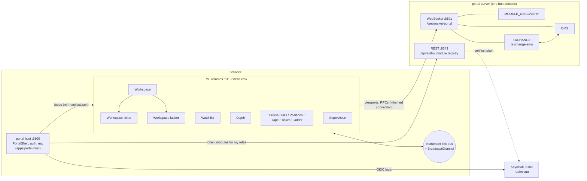

# Portal integration and the trader workspace

How the trading UI (`@heswell/trading-ui`) is delivered through vuu-portal: as module-federation (MF) features,
registered with the portal server, gated by roles, and composed into a prebuilt trader workspace. One command runs
the whole stack.

```sh
bun run start:all          # first run builds the host + features (≈30 s); then open http://localhost:5100
```

Log in as `alice` / `password` (see [Users and roles](#users-and-roles)).

## Architecture



| Part | Where | Source |
| --- | --- | --- |
| Keycloak (realm `vuu`, trading roles, seeded users) | `https://localhost:8180` (http 8181, management 9100) | `scripts/stack/keycloak-realm.ts`, `infra/keycloak/realm-vuu.json` |
| portal server + EXCHANGE + OMS | `wss://localhost:8191/websocket-portal`, `https://localhost:8543` | `apps/portal-config` |
| portal host (PortalShell) | `http://localhost:5100` | `apps/portal-host` |
| trading features (12 MF remotes) | `http://localhost:5110/<feature>/` | `apps/features/trading` |

There is no proxy. The host fetches the remotes directly, and the features server sends CORS headers. The
vuu-portal client in finos/vuu uses no haproxy either.

## Running

`bun run start:all` (also `bun run dev`) does the following:

1. Generates the dev certificate if missing and links vuu-websocket if needed. It builds the host and features if
   `dist` is missing, or always with `--build`.
2. Writes `apps/portal-config/application.stack.conf` (ports, CORS origin, Keycloak URL) and
   `default-modules.stack.yaml` (features origin). Both are gitignored. The vuu-portal ConfigFactory has no env
   overrides (upstream #46).
3. Checks that every port is free. A busy port is reported with the `TRADER_*` variable that moves it. It never
   takes over a port.
4. Starts Keycloak, unless one already answers at `TRADER_KEYCLOAK_URL` / `https://localhost:8180`:
   - It uses `KEYCLOAK_HOME`, or the newest `~/keycloak/keycloak-*`, in dev mode with state under `.run/keycloak`.
   - It then creates or updates the realm, roles and users.
   - Without a local install, run `docker compose up -d keycloak` first (see `docker-compose.yml`).
5. Starts the portal server, the features server and the host with prefixed logs.
6. Waits until every part answers and prints the URLs and users.
7. On Ctrl-C (or SIGTERM), stops everything it started: SIGTERM, then SIGKILL after 15 s.

| Flag | Effect |
| --- | --- |
| `--build` | rebuild the host and features first |
| `--reseed` | reset the portal's runtime module list (`modules.stack.yaml`) to the defaults. This also happens automatically when the defaults change. |
| `--prepare` | certs, builds and generated config only, then exit (for the `Procfile`) |

`Procfile` (overmind / foreman / honcho) runs the portal, features and host as separate processes. Before using it,
run `bun run start:all --prepare` and start a Keycloak.

### Ports

Every port can be changed with an env var (`scripts/stack/config.ts`). The defaults avoid the ports a stock
vuu-websocket / finos vuu-ui checkout uses (5001, 5006, 8080, 8091, 8443).

| Variable | Default |
| --- | --- |
| `TRADER_HOSTNAME` | `localhost` |
| `TRADER_KEYCLOAK_PORT` / `_HTTP_PORT` / `_MGMT_PORT` | 8180 / 8181 / 9100 |
| `TRADER_KEYCLOAK_URL` | `https://$TRADER_HOSTNAME:$TRADER_KEYCLOAK_PORT` (set it to use an existing Keycloak) |
| `TRADER_PORTAL_WS_PORT` / `TRADER_PORTAL_HTTPS_PORT` | 8191 / 8543 |
| `TRADER_HOST_PORT` | 5100 |
| `TRADER_FEATURES_PORT` / `TRADER_FEATURES_ORIGIN` | 5110 / `http://$TRADER_HOSTNAME:5110` |

## Users and roles

The roles are client roles of the `vuu-portal` client. The portal sends a user only the modules whose `accessRole`
they hold, and the OMS checks the same roles on every RPC (`packages/oms/README.md`).

| User (password `password`) | Roles | Sees |
| --- | --- | --- |
| alice, bob, carol, erin | trading-view, trading-execute | All of Trading (Workspace with ticket and ladder; Ticket; Ladder) |
| dave | trading-view | Workspace, Watchlist, Depth, Orders, Fills, Positions, Tape. No Ticket or Ladder, and a read-only order blotter. |
| sam | trading-view, trading-supervisor | As dave, plus Supervision › Desk overview (all accounts) |
| admin | trading-view, trading-supervisor, module-admin-access, vuu-table-viewer-access | Supervision, plus portal module admin |

The Keycloak admin console is at `https://localhost:8180/admin` (admin / admin). These are dev credentials only.
`bun run keycloak:realm export` rewrites `infra/keycloak/realm-vuu.json`, which docker-compose imports. Use
`bun run keycloak:realm bootstrap [--reset]` to apply the realm to a running Keycloak.

## Features

All features are built from one package, `apps/features/trading`, as **one MF remote per feature**. The portal
requires a unique `mfScope` per module (upstream #45). `src/catalog.ts` is the source of truth.
`bun run features:sync` generates `portal-build.json` and `apps/portal-config/default-modules.yaml` from it.
`bun run features:check` (run in CI) fails on drift and validates the yaml with the portal server's own loader.

| Nav | Module | Role | Content |
| --- | --- | --- | --- |
| Trading › Workspace | TradingWorkspace | trading-view | Prebuilt trader layout (below) |
| *(child)* | TradingWorkspaceTicket | trading-execute | Order ticket docked in the workspace |
| *(child)* | TradingWorkspaceLadder | trading-execute | Price ladder docked in the workspace |
| Trading › Watchlist | TradingWatchlist | trading-view | InstrumentGrid (sparklines, watchlists, Buy / Sell) |
| Trading › Depth | TradingDepth | trading-view | MarketDepth (own orders for the chosen account) |
| Trading › Ladder | TradingLadder | trading-execute | PriceLadder (click-to-trade) |
| Trading › Ticket | TradingTicket | trading-execute | OrderTicketPanel |
| Trading › Orders | TradingOrders | trading-view | OrderBlotter (read-only without trading-execute) |
| Trading › Fills | TradingFills | trading-view | FillsBlotter |
| Trading › Positions | TradingPositions | trading-view | PositionsView |
| Trading › Tape | TradingTape | trading-view | TradeTape |
| Supervision › Desk overview | TradingSupervisor | trading-supervisor | All visible accounts' orders and positions |

The workspace renders the ticket and ladder as **child modules** (`parentModuleId`, no nav entry), through
`usePortalModuleRegistry()` and `RemoteModule`. A user without trading-execute is not sent those modules, so the
workspace shows a placeholder in their place.

### Adding a feature

1. Add `src/features/<Name>.tsx`. Wrap the content with `withFeatureRoot` (see below) and give components stable
   `id`s, because they key saved state.
2. Add a catalog entry: unique `key`, `id`, `name`, `mfScope`; `location: "/Section/Label"` and `path` for a nav
   entry, or `parent` for a child module.
3. Run `bun run features:sync && bun run build`, then restart `start:all`. The module list is reseeded because the
   defaults changed.

### Per-host services: `TradingFeatureRoot`

Each feature wraps its content in `TradingFeatureRoot` (from `@heswell/trading-ui`). It mounts
`TradingNotificationsProvider` (with `InstrumentLookupProvider`), `OrderTicketLauncherProvider` and
`ConnectionBanner`:

- **Notifications are toasted once per window.** A window-global lease (`notificationLease`, kept on `globalThis`
  under a `Symbol.for` key) lets exactly one root stream order and fill notifications. When that feature closes,
  the lease passes to the oldest waiting root. With five features open, each fill is toasted once. The toast centre
  itself is the host's: PortalShell mounts the vuu NotificationsProvider.
- **Nested roots render children only.** The workspace's child modules render inside the parent's root, so Buy /
  Sell in the workspace grid targets the docked ticket.
- **The link bus is connected to `BroadcastChannel` once per window** (`ensureLinkBusBroadcast`, also called by the
  host). Popped-out features and other tabs stay linked.

Data access is `mode="inherit"`: features use the host's authenticated connection (`@vuu-ui/core` is a singleton).

### MF sharing

`scripts/features/sync-build-config.ts` writes the same `shared` block into the host and every remote:

| Shared singleton | Why |
| --- | --- |
| `react`, `react-dom`, `react-router-dom` | one React tree / router |
| `@vuu-ui/core`, `@vuu-ui/core/portal` | DataProvider, auth, module registry, persisted state |
| `@vuu-ui/vuu-data-remote`, `@vuu-ui/vuu-notifications`, `@salt-ds/core` | one connection manager, one toast centre, one Salt theme context |
| `@heswell/trading-ui` | one instrument link bus, launcher and notification lease per window |

There are two deviations from the P3.11 plan:

- **`@vuu-ui/vuu-layout` is not shared.** As a shared singleton it deadlocks startup: its shared chunk bundles
  vuu-data-react, which imports `@vuu-ui/vuu-layout` again, and the host page stays blank (upstream #43). Each
  remote has its own copy instead.
  - Consequence: `@heswell/trading-ui`, a singleton bound to the host's copy, does not see a remote's `View`s.
    Components therefore save their link group in the module's portal state (`trading.linkGroup.<id>`), not in View
    state (upstream #50).
- **The chunk-loading global is renamed per remote.** All remotes from one package get the same JSONP global, so
  loading two at once fails with `__webpack_modules__[moduleId] is not a function`. portal-build has no option for
  this, so `scripts/features/build.ts` renames it to `rspackChunk_<mfScope>` after each build (upstream #44).

`cssInline` includes `/packages/trading-ui/` for every package, and the feature package's own path for the
remotes. Do not include the host's own path: cssInline turns plain `.css` imports in included paths into strings,
so the host's CSS would not be applied (upstream #47).

## Layouts and saved state

The **trader workspace** is the prebuilt default layout. It contains the watchlist (red), Orders / Fills /
Positions tabs, the ticket (red, child module), depth (red), the ladder (green, child module) and the tape (green).
A green instrument picker sits in the toolbar, next to an account selector.

- Red follows the instrument grid, and green follows the picker. Every component has a link group selector.
- **Saved state** goes through the portal's `usePersistedState`. There is one state document per user and module,
  stored by PortalShell's default `LocalStoragePersistenceBackend`, so it is per browser. The vuu-portal server has
  no state persistence (upstream #49).
  - The workspace saves each View's state (`trader-workspace.views`) and each component's link group, and restores
    them on load.
  - A user's change of link group survives a reload; this was verified in a browser. **Reset layout** returns to
    the defaults.
- The arrangement (splitter sizes, moved views) is not saved. Restoring vuu-layout JSON needs the component
  registry, which is per bundle (upstream #53). The child modules (ticket, ladder) keep their own state, which Reset
  layout does not clear.
- The standalone features save their link groups the same way, keyed by component id.

## Troubleshooting

| Symptom | Fix |
| --- | --- |
| Login loops or "Unable to authenticate" | Open `https://localhost:8180`, `https://localhost:8543` and `https://localhost:8191` once and accept the self-signed certificate (or trust `apps/portal-config/certs/cert.pem`). |
| `port N (...) is in use` | Another process has it. Set the `TRADER_*` variable shown. |
| `no Keycloak` | Set `KEYCLOAK_HOME`, unpack Keycloak 26.x into `~/keycloak/`, or `docker compose up -d keycloak`. |
| A new or renamed feature is missing from the nav | `bun run start:all --build --reseed`. The portal keeps its runtime module list in `modules.stack.yaml`. |
| Blank page after changing `shared` | Do not share `@vuu-ui/vuu-layout` (upstream #43). Check the browser console for MF `RUNTIME-` errors. |
| `__webpack_modules__[moduleId] is not a function` | A remote was built without the chunk-global rename. Use `bun run build`, not portal-build directly. |
| Feature has no styles | Its CSS path is missing from `cssInline.include` (run `bun run features:sync`). |
| Docker Keycloak cannot read the key | `key.pem` is mode 600. On Linux, `chmod 644 apps/portal-config/certs/key.pem` (dev cert only). |
| Toasts appear twice | Each feature must use `TradingFeatureRoot` (or `withFeatureRoot`), not its own `TradingNotificationsProvider`. |

## Verified

Verified with Keycloak 26.4.2 (real OIDC login) and headless Chrome against `bun run start:all`. The scripts are
not in the repo. Screenshots are in [docs/screenshots](screenshots).

- **Order flow:** alice opens Trading › Ticket, buys 200 AAL.L at market, and gets "Filled 200 @ … O-…". The same
  order appears in Orders (Filled tab), Fills and Positions (`orders.png`, `fills.png`, `positions.png`,
  `ticket.png`).
- **Role gating:**
  - dave has no Ticket or Ladder in the nav. The workspace shows "needs trading-execute" placeholders, and his
    blotter has no amend, cancel or Cancel all (`workspace-dave-view-only.png`).
  - sam additionally gets Supervision › Desk overview (`supervisor-sam.png`).
- **Linking across separately loaded remotes:**
  - In the workspace, picking AAL.L in the green picker drives the ladder (a child remote) and the tape.
  - Clicking a watchlist row drives depth and the ticket (a child remote) (`workspace-linked.png`).
  - Clicking a row in the standalone Watchlist feature, then opening the Ticket and Depth features, shows that
    instrument (`watchlist.png`, `depth.png`).
- **Saved state:** switching the workspace's Depth to green survives a page reload, and Reset layout returns it to
  red.
- **Not verified:** `docker-compose.yml` (no Docker on the dev machine) and the `Procfile` under a process manager.
  `--prepare` was run.
