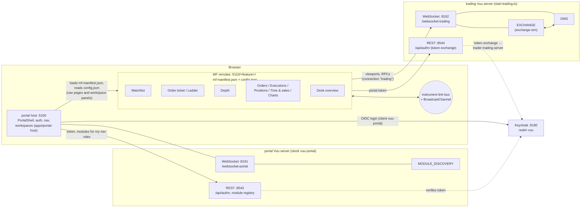

# Portal integration and the trader workspace

How the trading UI (`@heswell/trading-ui`) is delivered through vuu-portal: as module-federation (MF) features,
registered with the portal server, gated by roles, and composed into a Trader system workspace. One command runs
the whole stack.

```sh
bun run start:all          # first run builds the host + features (≈30 s); then open http://localhost:5100
```

Log in as `alice` / `password` (see [Users and roles](#users-and-roles)).

## Architecture



| Part | Where | Source |
| --- | --- | --- |
| Keycloak (realm `vuu`, clients, roles, seeded users) | `https://localhost:8180` (http 8181, management 9100) | `scripts/stack/keycloak-realm.ts`, `infra/keycloak/realm-vuu.json` |
| portal Vuu server (module registry) | `wss://localhost:8191/websocket-portal`, `https://localhost:8543` | `apps/portal-config/application.conf`, stock `@heswell/vuu-portal` (`bunx vuu-portal --config apps/portal-config/application.conf`) |
| trading Vuu server (EXCHANGE + OMS) | `wss://localhost:8192/websocket-trading`, `https://localhost:8544` | `apps/portal-config/application.trading.conf`, `src/start-trading.ts` |
| portal host (PortalShell) | `http://localhost:5100` | `apps/portal-host` |
| trading features (12 MF remotes) | `http://localhost:5110/<feature>/` | `apps/features/trading` |

### Two Vuu servers

The portal server only authenticates the user and serves the module registry. The trading tables (exchange-sim
and OMS) run in a separate process, the **trading server**. Each feature remote publishes a `config.json` next to
its `mf-manifest.json` (a @vuu-ui 4.0.0-alpha.21 mechanism):

```json
{
  "connectionId": "trading",
  "restUrl": "https://localhost:8544/api/authn",
  "websocketUrl": "wss://localhost:8192/websocket-trading"
}
```

`RemoteModule` reads it before mounting the remote:

1. It POSTs the user's `vuu-portal` access token to `restUrl`.
2. The trading server exchanges the token with Keycloak (standard token exchange) for a token of its own
   confidential client `trader-trading-server`, which carries the trading roles. It then returns a Vuu session
   token.
3. `RemoteModule` opens a websocket connection `trading` with that token. The connection is shared, ref-counted,
   by every remote with the same `connectionId`. It wraps the remote in an `AuthenticationProvider` scoped to that
   connection, so the trading-ui data sources and `useVuuAuthorizations()` use the trading session without any
   code changes.

`scripts/features/build.ts` writes `dist/<feature>/config.json` from the `TRADER_*` variables below, and the
features server (`scripts/stack/serve.ts`) regenerates it on every request from its own environment. To point the
remotes at a trading server elsewhere, set `TRADER_TRADING_REST_URL` and `TRADER_TRADING_WEBSOCKET_URL`.
`RemoteModule` treats a missing `config.json` as an error, so every remote must publish one (`{}` means "use the
portal server"; trader upstream issue 57).

There is no proxy. The host fetches the remotes directly, and the features server sends CORS headers. The
vuu-portal client in finos/vuu uses no haproxy either.

The host can be opened at `http://localhost:5100` or `http://127.0.0.1:5100`. Both Vuu servers list both origins
(and the features server's) in `vuu.auth.cors.allowedOrigins`, and the realm's vuu-portal client has both as
redirect URIs. With other `TRADER_*` ports or hostname, `start:all` passes the derived list as
`VUU_CORS_ALLOWED_ORIGINS` and adds the origins to the realm.

## Running

`bun run start:all` (also `bun run dev`) does the following:

1. Generates the dev certificate if missing. It builds the host and features if `dist` is missing, or always with
   `--build`.
2. Writes `apps/portal-config/default-modules.stack.yaml` (features origin, gitignored). The servers run on the
   committed `application.conf` / `application.trading.conf`; ports, CORS origins and Keycloak URL reach them as
   per-process env vars (`VUU_HTTPS_PORT`, `VUU_WEBSOCKET_PORT`, `VUU_CORS_ALLOWED_ORIGINS`, `VUU_KEYCLOAK_URL`,
   `VUU_PORTAL_DEFAULT_MODULES_FILE`, `VUU_PORTAL_MODULES_FILE`), derived from the `TRADER_*` settings
   (`scripts/stack/config.ts` `serverEnv`) and read by the confs' `key=${?VUU_*}` lines.
3. Checks that every port is free. A busy port is reported with the `TRADER_*` variable that moves it. It never
   takes over a port.
4. Starts Keycloak, unless one already answers at `TRADER_KEYCLOAK_URL` / `https://localhost:8180`:
   - It uses `KEYCLOAK_HOME`, or the newest `~/keycloak/keycloak-*`, in dev mode with state under `.run/keycloak`.
   - It then creates or updates the realm, roles and users.
   - Without a local install, run `docker compose up -d keycloak` first (see `docker-compose.yml`).
5. Starts the portal server (the stock `@heswell/vuu-portal/main`), the trading server (`start-trading.ts`), the
   features server and the host with prefixed logs, each via `scripts/stack/serve.ts portal|trading|features|host`.
6. Waits until every part answers and prints the URLs and users.
7. On Ctrl-C (or SIGTERM), stops everything it started: SIGTERM, then SIGKILL after 15 s.

| Flag | Effect |
| --- | --- |
| `--build` | rebuild the host and features first |
| `--reseed` | reset the portal's runtime module list (`modules.stack.yaml`) to the defaults. This also happens automatically when the defaults change. |
| `--prepare` | certs, builds and the generated module list only, then exit (for the `Procfile`) |

`Procfile` (overmind / foreman / honcho) runs the portal server, trading server, features and host as separate
processes with the same `scripts/stack/serve.ts` entries, so `TRADER_*` overrides apply too. Before using it, run
`bun run start:all --prepare` and start a Keycloak.

Outside `start:all`, the portal server is the stock bin: `bunx vuu-portal --config apps/portal-config/application.conf`
(or `VUU_CONFIG_FILE=...`); set `VUU_HTTPS_PORT` etc. to move it.

### Ports

Every port can be changed with an env var (`scripts/stack/config.ts`). The defaults avoid the ports a stock
vuu-websocket / finos vuu-ui checkout uses (5001, 5006, 8080, 8091, 8443).

The OMS generates background order flow for every account (`OMS_FLOW_ACCOUNTS`, see `packages/oms/README.md`).
The screenshots were taken with `OMS_FLOW_ACCOUNTS=ACC-US-02,ACC-EU-01,ACC-EU-02,ACC-ASIA-01,ACC-ASIA-02`, so
alice's account `ACC-US-01` only has her own orders.

| Variable | Default |
| --- | --- |
| `TRADER_HOSTNAME` | `localhost` |
| `TRADER_KEYCLOAK_PORT` / `_HTTP_PORT` / `_MGMT_PORT` | 8180 / 8181 / 9100 |
| `TRADER_KEYCLOAK_URL` | `https://$TRADER_HOSTNAME:$TRADER_KEYCLOAK_PORT` (set it to use an existing Keycloak) |
| `TRADER_PORTAL_WS_PORT` / `TRADER_PORTAL_HTTPS_PORT` | 8191 / 8543 |
| `TRADER_TRADING_WS_PORT` / `TRADER_TRADING_HTTPS_PORT` | 8192 / 8544 |
| `TRADER_TRADING_REST_URL` / `TRADER_TRADING_WEBSOCKET_URL` | derived from the two ports above (written to each remote's `config.json`) |
| `TRADER_TRADING_CLIENT_SECRET` | `trader-trading-local-dev-secret` (the `trader-trading-server` client secret; dev only) |
| `TRADER_HOST_PORT` | 5100 |
| `TRADER_FEATURES_PORT` / `TRADER_FEATURES_ORIGIN` | 5110 / `http://$TRADER_HOSTNAME:5110` |
| `TRADER_LOG_LEVEL` | unset = `info`. Passed to both Vuu servers as `VUU_LOG_LEVEL` (`trace`, `debug`, `info`, `warn`, `error` or `silent`) |

### Sessions per user

Each browser tab opens one Vuu session on the portal server and one on the trading server (the trading modules in a
tab share a ref-counted connection). Every trader conf sets

```
vuu.server.maxSessionsPerUser=5
vuu.server.sessionLimitPolicy="reject-new"
```

so a user can work in up to five tabs. A sixth login is refused: vuu-server closes its socket with code `4003`
(`maximum sessions (5) reached for user …`) and the existing tabs carry on. Closing or reloading a tab frees its
session at once, so a reload at the limit still works. The refused tab shows a blank page and does not retry when
a slot frees up (upstream issue 74); reload it once another tab is closed.

`evict-oldest` (close the oldest session with `4001`) would suit traders better, because a forgotten tab could not
block a new one. But vuu-ui ignores the close code and reconnects an evicted tab after a second, which then evicts
the next oldest, so with more tabs than the limit every tab is disconnected in turn, forever (upstream issue 73).
Switch to `evict-oldest` once that is fixed. Override the settings with `VUU_MAX_SESSIONS_PER_USER` /
`VUU_SESSION_LIMIT_POLICY` (set them in the shell before `start:all`; they apply to both servers).

## Users and roles

There are two sets of client roles, because the portal and the trading server are separate Keycloak clients:

- **Server roles** belong to the confidential client `trader-trading-server`: `trading-view`, `trading-execute`
  and `trading-supervisor`. They reach the trading server through token exchange, and the OMS checks them on
  every viewport and RPC (`oms.permissionMode="strict"`, `packages/oms/README.md`). Inside a feature,
  `useEntitlements()` reads them with `useVuuAuthorizations()`.
- **Nav roles** belong to the public `vuu-portal` client: `trading-access`, `trading-execute-access` and
  `trading-supervisor-access`. They are the modules' `accessRole`s, so the portal sends a user only the modules
  they may open. The realm bootstrap derives them from each user's server roles (`TRADING_ACCESS_ROLE` in
  `catalog.ts`), so the two sets always agree.

The `vuu-portal` client adds both `vuu-portal-server` and `trader-trading-server` to its tokens' audience, which
standard token exchange requires.

| User (password `password`) | Server roles (`trader-trading-server`) | Sees |
| --- | --- | --- |
| alice, bob, carol, erin | trading-view, trading-execute | Every entry except Oversight (the Trader workspace with its ticket and ladder panels; Price ladder) |
| dave | trading-view | As alice, but no Price ladder; the workspace's Ticket and Ladder panels say the module is not available, the Panels palette has no Order ticket or Price ladder, and the order blotter is read-only. |
| sam | trading-view, trading-supervisor | As dave, plus Oversight › Desk overview (all accounts) |
| admin | trading-view, trading-supervisor (plus `vuu-portal` module-admin-access, vuu-table-viewer-access) | As sam, plus portal module admin |

The Keycloak admin console is at `https://localhost:8180/admin` (admin / admin). These are dev credentials only.
`bun run keycloak:realm export` rewrites `infra/keycloak/realm-vuu.json`, which docker-compose imports. Use
`bun run keycloak:realm bootstrap [--reset]` to apply the realm to a running Keycloak.

## Features

All features are built from one package, `apps/features/trading`, as **one MF remote per feature**. The portal
requires a unique `mfScope` per module (trader upstream issue 45). `src/catalog.ts` is the source of truth.
`bun run features:sync` generates `portal-build.json` and `apps/portal-config/default-modules.yaml` from it.
`bun run features:check` (run in CI) fails on drift and validates the yaml with the portal server's own loader.

The Role column is the server role. The module's `accessRole` is the matching nav role (`trading-view` →
`trading-access`, and so on).

The nav is sorted by `navOrder`; a section sorts by its lowest entry. `navBadge` names a live badge the host
renders, and `notificationTopics` are the trading server's notification topics the entry claims (see
[the portal host](#portal-host-nav)).

| id | Nav | Path | Module | Role | navOrder | Badge / topics | Palette | Content |
| --- | --- | --- | --- | --- | --- | --- | --- | --- |
| 110 | Trading › Watchlist | `/trading/watchlist` | TradingWatchlist | trading-view | 100 | marketdata | Trading, 2×1 | InstrumentGrid (sparklines, watchlists, Buy / Sell) |
| 114 | Trading › Orders | `/trading/orders` | TradingOrders | trading-view | 110 | `orders.working`; orders | Trading, 2×1 | OrderBlotter (read-only without trading-execute) |
| 115 | Trading › Executions | `/trading/executions` | TradingFills | trading-view | 120 | fills | Trading, 2×1 | FillsBlotter |
| 112 | Trading › Price ladder | `/trading/price-ladder` | TradingLadder | trading-execute | 130 | orders | Trading, 1×2 | PriceLadder (click-to-trade) |
| 124 | — (palette only) | — | TradingTicket | trading-execute | — | orders | Trading, 1×2 | OrderTicket (`showInstrumentPicker`) |
| 111 | Market › Market depth | `/market/depth` | TradingDepth | trading-view | 200 | marketdata | Market, 1×2 | MarketDepth (own orders for the chosen account) |
| 117 | Market › Time & sales | `/market/time-and-sales` | TradingTape | trading-view | 210 | marketdata | Market, 1×2 | TradeTape |
| 118 | Market › Chart | `/market/chart` | TradingChart | trading-view | 220 | | Market, 2×1 | PriceChart |
| 119 | Market › Depth chart | `/market/depth-chart` | TradingDepthChart | trading-view | 230 | | Market, 2×1 | DepthChartView |
| 116 | Portfolio › Positions | `/portfolio/positions` | TradingPositions | trading-view | 300 | `positions.dayPnl`; positions, risk | Portfolio, 2×1 | PositionsView |
| 121 | Portfolio › P&L | `/portfolio/pnl` | TradingPnl | trading-view | 310 | | Portfolio, 2×1 | Account P&L history (PnlHistoryChart) |
| 122 | Portfolio › Exposure | `/portfolio/exposure` | TradingExposure | trading-view | 320 | risk | Portfolio, 2×1 | ExposureTreemap |
| 123 | Portfolio › Execution quality | `/portfolio/execution-quality` | TradingExecutionQuality | trading-view | 330 | | Portfolio, 2×1 | SlippageChart |
| 120 | Oversight › Desk overview | `/oversight/desk` | TradingSupervisor | trading-supervisor | 400 | risk, orders | — | All visible accounts' orders and positions |

Module ids are stable. The vuu-layout Trader workspace (100) and its child modules (101 ticket, 102 ladder) are
retired: the Trader workspace is now a portal workspace (below) made of the modules above, and the ticket is module
124. The former standalone ticket (113) and Analytics feature (split into 121–123) are gone too.

**Palette** is the module's `workspace` descriptor (`VuuModuleDescriptor.workspace`: `paletteGroup` and
`defaultSize` in grid tracks, cols × rows). Only modules with it are offered in the portal's Panels palette and can
be panels of a workspace; the palette icon is the nav icon. Groups follow the nav sections. Wide blotters and
charts default to 2×1 (split below the target), tall ladder / depth / tape / ticket panels to 1×2 (split beside
it).

- **Excluded: Desk overview (120).** It is a page-sized, desk-wide composite (orders with child orders, and
  positions, over every account) that follows no link group. It gains nothing next to instrument panels and is
  cramped as one, so it stays a nav page.
- **Order ticket (124) is palette-only:** it has `workspace` metadata but no nav location or route, so PortalNav
  and the routes skip it while the Panels palette lists it (module-admin / vuu-portal 2.3.0, @vuu-ui alpha.28).
  `modulesYaml` omits `location` / `path` when a feature has none. Buy / Sell anywhere opens the ticket as a
  dialog unless a ticket panel is open (see below).

### Adding a feature

1. Add `src/features/<Name>.tsx`. Wrap the content with `withFeatureRoot` (see below) and give components stable
   `id`s, because they key saved state.
2. Add a catalog entry: unique `key`, `id`, `name`, `mfScope`; for a nav entry `location: "/Section/Label"`,
   `path`, `navOrder` and `navIcon` (an outline icon in `navIcons.ts`), optionally `navBadge` and
   `notificationTopics`; or `parent` for a child module. Add `workspace: {paletteGroup, defaultSize}` if it can be
   a workspace panel (most features), and accept `defaultLinkGroup` so a workspace can set its group.
3. Run `bun run features:sync && bun run build`, then restart `start:all`. The module list is reseeded because the
   defaults changed.

### Per-host services: `TradingFeatureRoot`

Each feature wraps its content in `TradingFeatureRoot` (from `@heswell/trading-ui`). It mounts
`TradingNotificationsProvider` (with `InstrumentLookupProvider`), `OrderTicketLauncherProvider` and
`ConnectionBanner`:

- **Notifications are toasted once per window.** A window-global lease (`notificationLease`, kept on `globalThis`
  under a `Symbol.for` key) lets exactly one root stream order and fill notifications. When that feature closes,
  the lease passes to the oldest waiting root. With five features open, each fill is toasted once. The toast centre
  itself is the host's: PortalShell mounts the vuu NotificationsProvider.
- **Nested roots render children only,** so a feature can render inside another one's root.
- **Buy / Sell targets an open ticket panel.** A ticket rendered as a workspace panel registers itself as a docked
  target window-wide, so Buy / Sell in any panel (each its own root) prefills it rather than opening a dialog.
- **The link bus is connected to `BroadcastChannel` once per window** (`ensureLinkBusBroadcast`, also called by the
  host). Popped-out features and other tabs stay linked.

Data access is `mode="inherit"`: features use the connection `RemoteModule` provides, which is the trading server
connection from `config.json` (see [Two Vuu servers](#two-vuu-servers)). `@vuu-ui/core` is a singleton.

### MF sharing

`scripts/features/sync-build-config.ts` writes the same `shared` block into the host and every remote:

| Shared singleton | Why |
| --- | --- |
| `react`, `react-dom`, `react-router-dom` | one React tree / router |
| `@vuu-ui/core`, `@vuu-ui/core/portal` | DataProvider, auth, module registry, persisted state |
| `@vuu-ui/vuu-data-remote`, `@vuu-ui/vuu-notifications`, `@salt-ds/core` | one connection manager, one toast centre, one Salt theme context |
| `@heswell/trading-ui` | one instrument link bus, launcher and notification lease per window |

There are two deviations from the P3.11 plan:

- **`@vuu-ui/vuu-layout` is not shared.** As a shared singleton it deadlocks startup: its shared chunk bundles
  vuu-data-react, which imports `@vuu-ui/vuu-layout` again, and the host page stays blank (trader upstream issue 43). Each
  remote has its own copy instead.
  - Consequence: `@heswell/trading-ui`, a singleton bound to the host's copy, does not see a remote's `View`s.
    Components therefore save their link group in the module's portal state (`trading.linkGroup.<id>`), not in View
    state (trader upstream issue 50).
- **The chunk-loading global is renamed per remote.** All remotes from one package get the same JSONP global, so
  loading two at once fails with `__webpack_modules__[moduleId] is not a function`. portal-build has no option for
  this, so `scripts/features/build.ts` renames it to `rspackChunk_<mfScope>` after each build (trader upstream issue 44).

`cssInline` includes `/packages/trading-ui/` for every package, and the feature package's own path for the
remotes. Do not include the host's own path: cssInline turns plain `.css` imports in included paths into strings,
so the host's CSS would not be applied (trader upstream issue 47).

## Portal host nav

`apps/portal-host` renders `<PortalShell header={false}>` with `PortalNav` (`src/nav/TraderNav.tsx`) as its only
chrome; there is no `PortalHeader` or `PortalAppSwitcher`.

- **Display modes.** Icons and text by default, all four modes allowed, `collapseTo="icons"`, section headings.
  ⌘B / Ctrl+B (or the chevron) toggles between the expanded mode and icons; the user menu's Icons and text / Text
  only / Icons only / Hidden items pick any mode (PortalNav has no built-in picker). The mode is saved
  (`nav/displayMode`). In Hidden, the edge handle opens the nav as an overlay with a "Keep navigation open" pin.
- **Brand.** The logo, "Trader", an environment chip when `config.json` has an `environment` string (e.g.
  `"UAT"`), and the notifications bell (`NotificationsIndicator scope="unclaimed"`). In the icon rail, the logo
  expands the nav and the bell stacks under it.
- **Footer.** `PortalConnectionStatus` labels the portal's own connection "Portal" and the trading server's
  "Trading", each with its impact when down. `PortalNavUserMenu` shows the user's trading account (none for a
  supervisor) and has Saved state… and Log out. Both use the `rail` variant in the icon rail.
- **Badges.** `TradingNavFeed` opens three small viewports on the trading connection (the one the modules'
  `config.json` names, found as the `ConnectionStatusIndicator` did): `parentOrders` with the Orders blotter's
  Working-tab filter (`orders.working`: the row count), `positionPrices` (`positions.dayPnl`: the sum of
  `totalPnlUsd`, i.e. total P&L in USD, shown compact, signed and green / red), and `accounts` filtered to
  `owner = <user>` (the user menu's account). The server's permission filter scopes all three, so a supervisor's
  badges cover every account.
- **Notification topics.** The trading server publishes a `NOTIFICATIONS` module (vuu-server's generic
  `notifications` table plus `account`, `ric` and `orderId`, filtered per user by account like the OMS tables).
  The OMS writes:

  | Event | topic | level | type |
  | --- | --- | --- | --- |
  | Parent order rejected (risk or exchange) | `orders` | ERROR | silent (the feature already toasts it) |
  | Position at 80% of the account's `maxPositionNotional` | `risk` | WARNING | toast |
  | Position at or over the limit | `risk` | ERROR | toast |

  The portal routes each row to the modules on the trading connection that claim its topic in
  `notificationTopics` (a dot in the nav, worst unread severity; opening the page marks it read). An unclaimed
  topic goes to the bell only. Rows expire after 15 minutes (rejects) or 30 minutes (risk). Fills are not
  published (the background flow fills continuously); the features still toast the user's own fills.

## Workspaces and saved state

The host passes PortalShell `workspaces` (`apps/portal-host/src/workspaces`): the portal component registries
(`createPortalComponentRegistries()`, i.e. `portal-module` and `vuu-table` items) and one **system workspace**,
Trader (`/workspaces/trader`). It is a v2 `GridLayoutDocument` (`traderWorkspace.ts`) of `portal-module` items, each
naming a palette module and its props:

| Column (7 : 5 : 5) | Top | Bottom |
| --- | --- | --- |
| Left | Instruments (Watchlist, red) | stack: Orders, Fills (red), Positions (green) |
| Middle | Ticket (red) | stack: Chart, Depth, Depth chart (red) |
| Right | Ladder (green, with an instrument picker) | Tape (green, `showInstrumentPicker: false`) |

Red follows the instruments grid, green follows the ladder's picker. Every panel has a link group selector.

- **Default and personal copy.** Trader opens as the default (nav chip "default"). The first edit (moving or
  closing a panel, changing a link group) saves a personal copy with the same id ("Your
  copy" in the nav and header). Selecting a stack tab is view state: it is saved but is not an edit. **Reset to default** in the header (only on a copy) restores the system document,
  optionally saving the copy as a new workspace first.
- **New workspace** (nav entry or +) creates an empty named workspace (renamed and deleted from its nav menu). It
  opens with the Panels palette and the empty-workspace drop zone: drop a module on it, or click one.
- **Per-panel state.** A panel's link group is saved in its item's workspace component state
  (`trading.feature-state`, key `trading.linkGroup.<id>`), so it travels with the workspace and resets with it.
  `defaultLinkGroup` (an item prop) sets a panel's group until the user picks one.
- **Storage.** Workspaces and the nav pages' own state (`usePersistedState`, `trading.linkGroup.<id>`) use
  PortalShell's default `LocalStoragePersistenceBackend`, so they are per browser; the vuu-portal server has no
  state persistence (trader upstream issue 49).
- **Panel access.** A panel whose module the user is not sent (e.g. Ticket and Ladder for dave) shows the
  portal's "module not available" message.

### Panels palette (Phase 6 X2)

The workspace header's **Add panel** (`AddPanelButton` from `@vuu-ui/core/portal`, passed as PortalShell
`workspaces.headerActions`) opens the core `PanelsPalette` in the shell context panel. The host sets
`contextPanel={{placement: "inline"}}`, so the palette sits beside the workspace (which narrows) instead of over it:
the user can see where a panel will go while dragging. The palette closes after a click or + adds a panel and can be
pinned open.

- **Modules tab:** every module the user is sent that has `workspace` metadata, grouped by `paletteGroup` (Trading:
  Watchlist, Orders, Executions, Price ladder, Order ticket; Market: Market depth, Time & sales, Chart, Depth
  chart; Portfolio: Positions, P&L, Exposure, Execution quality), with a search box. Desk overview has no
  `workspace` metadata (it is a page, not a panel), so it is not offered.
- **Recent tab:** the panels the user added last (portal saved state `workspace/recentPanels`, per browser).
- **Tables tab: not wanted, but shown.** Trader's tables are reached through its modules (a raw `vuu-table` panel
  has no ticket actions, link group or formatting), so the palette should offer only Modules and Recent. The core tab
  set is fixed and the host cannot pass `PanelsPalette` props, so the Tables tab (listing the trading server's
  tables) is still there, as is the "Drag modules or tables" copy of the empty drop zone (trader upstream issue
  107). It is harmless: a table added from it is an ordinary `vuu-table` panel.
- **Row actions** (core `useOpenPanel()` / `usePortalDragSource()`):
  - **click** follows the click rule: no panel → add; one panel → replace it; more → a prompt *Replace
    <focused>* (R) / *Open as new tab* (T), Esc to cancel (`workspace-palette-prompt.png`);
  - **drag** places the panel exactly: the drop target ghost (edge to split, centre or header to tab) and a hint bar
    at the bottom, Esc to cancel. Dragging never prompts (`workspace-palette-drag.png`);
  - **+** adds the panel beside the focused one (or into empty space), never prompting.
- **Link groups of added panels.** A palette panel is the module's `portalModuleTemplate()` with no props, so it
  joins the module's own default group: red for Watchlist, Orders, Executions, Order ticket, Market depth, Chart and
  Depth chart; green for Price ladder, Time & sales and Positions. An added Order ticket therefore follows the
  Instruments grid at once, and an added Time & sales follows the Ladder's picker. The user changes it with the
  panel's link group selector, which is saved per item as above. Following the focused panel's group was rejected:
  it makes the result depend on what happened to be focused, and a Ticket dropped next to the Ladder would follow
  the picker rather than the grid.
- **Instrument pickers.** Price ladder and Time & sales show their instrument picker unless
  `showInstrumentPicker: false`, so a palette Ladder or Tape (and their nav pages) can choose an instrument on its
  own. The Trader document sets `false` on its Tape, which follows the Ladder. A personal copy saved before this
  change has no such prop, so its Tape shows a picker too until Reset to default.
- **Persistence.** Adding a panel is an edit: the default becomes "Your copy", and the added panels (and their link
  groups) survive a reload. Reset to default removes them.
- **Permissions: hidden, not disabled.** The palette lists only modules the portal server sends the user, and
  Order ticket and Price ladder need trading-execute (`accessRole`), so dave and sam do not see them
  (`workspace-palette-dave.png`). Showing them disabled with a reason would need the descriptors of modules the
  user may not load, which vuu-portal deliberately does not send; it would also suggest the user could ask for them
  from the palette. The nav already hides them, so the palette matches it. Panels already in a document (the
  Trader Ticket and Ladder) keep the "module not available" placeholder.

## Troubleshooting

| Symptom | Fix |
| --- | --- |
| Login loops or "Unable to authenticate" | Open `https://localhost:8180`, `https://localhost:8543`, `https://localhost:8191`, `https://localhost:8544` and `https://localhost:8192` once and accept the self-signed certificate (or trust `apps/portal-config/certs/cert.pem`). |
| A feature shows "Invalid remote module config" | Its `config.json` is missing or invalid. Rebuild with `bun run build`, or check `http://localhost:5110/<feature>/config.json`. |
| Features load but show no data | The trading server is down, or its certificate is not accepted (`https://localhost:8544`). Check the `trading` log prefix. Token exchange failures (401) mean the realm is missing the `trader-trading-server` client: run `bun run keycloak:realm bootstrap`. |
| `port N (...) is in use` | Another process has it. Set the `TRADER_*` variable shown. |
| `no Keycloak` | Set `KEYCLOAK_HOME`, unpack Keycloak 26.x into `~/keycloak/`, or `docker compose up -d keycloak`. |
| A new or renamed feature is missing from the nav | `bun run start:all --build --reseed`. The portal keeps its runtime module list in `modules.stack.yaml`. |
| Blank page after changing `shared` | Do not share `@vuu-ui/vuu-layout` (trader upstream issue 43). Check the browser console for MF `RUNTIME-` errors. |
| `__webpack_modules__[moduleId] is not a function` | A remote was built without the chunk-global rename. Use `bun run build`, not portal-build directly. |
| Feature has no styles | Its CSS path is missing from `cssInline.include` (run `bun run features:sync`). |
| Docker Keycloak cannot read the key | `key.pem` is mode 600. On Linux, `chmod 644 apps/portal-config/certs/key.pem` (dev cert only). |
| Toasts appear twice | Each feature must use `TradingFeatureRoot` (or `withFeatureRoot`), not its own `TradingNotificationsProvider`. |

## Verified

### Workspaces (alpha.28)

Verified with @vuu-ui 4.0.0-alpha.28, vuu-server 4.3.0, vuu-portal 2.3.0, module-admin 2.3.0 and headless Chrome
(1600×1000) against `bun run start:all --build --reseed`.

- **Trader system workspace:** alice opens Workspaces › Trader as the default, with panels Instruments, Ticket,
  Ladder and Tape and the two stacks (`workspace-trader.png`).
- **Linking:** a grid row drives the ticket, chart and depth (red); the ladder's picker drives the ladder and tape
  (green) and leaves the ticket alone (`workspace-linked.png`). Neither is an edit, nor is selecting a stack tab.
- **Docked ticket:** Sell in the instruments grid prefills the Ticket panel (side Sell), with no dialog.
- **Personal copy:** switching the ticket to green and closing Tape makes "Your copy"; both survive a reload
  (`workspace-personal-copy.png`). Reset to default (`workspace-reset-confirm.png`) restores the default, Tape and
  red. The scrolled instruments grid keeps its rows when the copy is created, and the console stays free of
  errors throughout.
- **Palette-only ticket:** Order ticket is not in the nav, and its Ticket panel still loads.
- **New workspace** opens an empty, renamable workspace (`workspace-new.png`).
- **Roles:** dave's Ticket and Ladder panels say the module is not available, and he has no Buy / Sell
  (`workspace-dave-view-only.png`); sam also has Oversight › Desk overview (`workspace-sam.png`).
- `bun run e2e:persistence` and `bun run e2e:resilience` pass against the workspace.

### Panels palette (alpha.28)

Verified with @vuu-ui 4.0.0-alpha.28, vuu-portal 2.3.0, module-admin 2.3.0 and headless Chrome (1600×1000)
against `bun run start:all --build`. `bun run e2e:palette` (`scripts/e2e/palette.ts`) repeats it on its own
stack.

- **Palette:** Add panel opens the palette inline in the context panel, grouped Trading / Market / Portfolio
  (`workspace-palette.png`).
- **+:** + on Order ticket adds a red ticket that shows the grid's instrument at once and makes "Your copy"
  (`workspace-personal-copy.png`).
- **Click rule:** with more than one panel, clicking P&L prompts "Replace Order ticket (R) / Open as new tab (T)";
  Esc changes nothing, T stacks P&L with the ticket (`workspace-palette-prompt.png`).
- **Drag:** dragging Exposure shows the hint bar and the drop ghost, and dropping it on the Instruments panel's
  bottom edge splits it, with no prompt (`workspace-palette-drag.png`).
- **Reload and Recent:** the added panels survive a reload, and Recent lists them.
- **Reset to default** (`workspace-reset-confirm.png`) removes them and restores the eight default panels.
- **New workspace:** opens with the palette and the drop zone (`workspace-new.png`); clicking Watchlist adds it,
  clicking Price ladder then replaces it, and + adds Time & sales and Order ticket. Watchlist (red) drives the
  ticket; the Ladder's picker (green) drives Time & sales (`workspace-palette-linked.png`).
- **Roles:** dave's and sam's palettes have no Order ticket or Price ladder (`workspace-palette-dave.png`); sam's
  has no Desk overview.
- **Not available upstream:** the design's drop compass (trader upstream issue 108) and hiding the Tables tab
  (107).
- `bun run e2e:persistence`, `bun run e2e:resilience` and `bun run e2e:palette` pass.

### PortalNav (alpha.25)

Verified with @vuu-ui 4.0.0-alpha.25, vuu-server 4.2.2, vuu-portal 2.2.3, module-admin 2.1.0 and headless Chrome
against `bun run start:all`, with `OMS_FLOW_ACCOUNTS=ACC-US-02,ACC-EU-01,ACC-ASIA-01,ACC-ASIA-02`. (First verified
on alpha.23 with a locally built module-admin; trader upstream issue 99, now resolved.)

- **IA and roles:** alice sees Workspaces, Trading, Market and Portfolio with the account ACC-US-01
  (`nav-badges-dots.png`); dave has no Price ladder, ACC-EU-02 and the workspace placeholders (`nav-dave.png`); sam
  also gets Oversight › Desk overview, no account, and desk-wide badges (`nav-sam.png`).
- **Badges:** a limit buy below the bid takes Orders from 0 to 1; after a market buy, Positions shows a signed red /
  green P&L that moves with the market.
- **Notification topics:** a limit buy at half the price, placed from the Watchlist's Buy dialog, is rejected;
  Trader, Orders and Price ladder (which claim `orders`) get a red dot. Opening Orders clears them. Read state is per browser session: a new session shows the dots again until the
  rows expire.
- **Modes:** icons and text, text (`nav-text.png`), icons (⌘B; the connection popover lists Portal and Trading,
  `nav-rail-connection.png`) and hidden (edge handle, overlay, "Keep navigation open"). The mode survives a reload.
- **User menu:** identity, account and roles, Saved state…, the display modes and Log out (`nav-user-menu.png`).

### Earlier phases

Verified with @vuu-ui 4.0.0-alpha.22, Keycloak 26.4.2 (real OIDC login and token exchange) and headless Chrome
against `bun run start:all`, with the trading modules on the standalone trading server. The scripts are not in the
repo. Screenshots are in [docs/screenshots](screenshots).

- **Token exchange:** each page load exchanges the `vuu-portal` token once at `https://localhost:8544/api/authn`
  (200). Every remote shares the one `trading` connection, and the OMS applies the exchanged token's roles in
  `strict` mode.
- **Order flow:** alice opens Trading › Ticket, buys 200 AAL.L at market, and gets "Filled 200 @ … O-…". The same
  order appears in Orders (Filled tab), Fills and Positions (`orders.png`, `fills.png`, `positions.png`,
  `ticket.png`).
- **Role gating:**
  - dave has no Ticket or Ladder in the nav. The workspace shows "needs trading-execute" placeholders, and his
    blotter has no amend, cancel or Cancel all (`workspace-dave-view-only.png`).
  - sam additionally gets Supervision › Desk overview and sees every account (`supervisor-sam.png`).
- **Linking across separately loaded remotes:**
  - In the workspace, picking BARC.L in the green picker drives the ladder (a child remote) and the tape.
  - Clicking a watchlist row drives depth and the ticket (a child remote) (`workspace-linked.png`).
  - Clicking a row in the standalone Watchlist feature, then opening the Ticket and Depth features from the nav,
    shows that instrument (`watchlist.png`, `depth.png`). Link state lives in the page, so a full reload clears it.
- **Saved state** (verified in Phase 4 on alpha.20, not re-run): switching the workspace's Depth to green survives a
  page reload, and Reset layout returns it to red.
- **Not verified:** `docker-compose.yml` (no Docker on the dev machine) and the `Procfile` under a process manager.
  `--prepare` was run.
