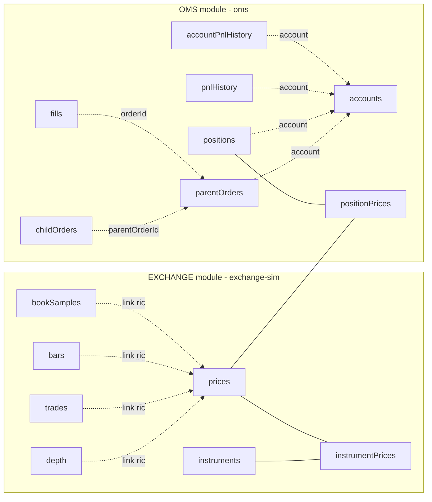

# Trading schemas overview

All table contracts, enums and RPCs live in
[`packages/trading-schemas`](../packages/trading-schemas/README.md) and are
defined once, as plain data. Adapters derive the vuu-ui `TableSchema`
(`toTableSchema`) and vuu-server `TableDef`s / join factories
(`@heswell/trading-schemas/server`).

| Module | Tables | Joins |
|---|---|---|
| `EXCHANGE` | instruments, prices, depth (`ric\|side\|level`), trades, bars (`ric\|interval\|start`), bookSamples (`ric\|time`) | instrumentPrices = instruments ⟕ prices |
| `OMS` | accounts, parentOrders, childOrders, fills, positions (`account\|ric`), pnlHistory (`account\|ric\|time`), accountPnlHistory (`account\|time`) | positionPrices = positions ⟕ prices (cross-module) |

Order entry follows the protocol parity decision (`docs/protocol-parity.md`, #1): direct
`RPC_REQUEST`s (`createOrder`, `amendOrder`, `cancelOrder`, `cancelAll`) with
`VIEWPORT_CONTEXT`, answered with `SUCCESS_RESULT {orderId, status}` or
`ERROR_RESULT "<RejectReason>: <text>"`. The exchange simulator exposes admin
RPCs `setVolatility`, `haltInstrument`, `resumeInstrument`, `setBotRate`, `setMarketPhase`.

Order status semantics (FIX-like, `ORDER_STATUS_TRANSITIONS`) and tick/lot
validation (`validateOrder`) are shared so that the order ticket, blotters and
OMS agree. See the package README for full column lists and signatures.
