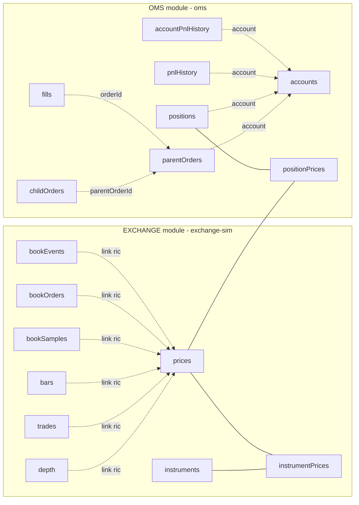

# Trading schemas overview

All table contracts, enums and RPCs live in
[`packages/trading-schemas`](../packages/trading-schemas/README.md) and are
defined once, as plain data. Adapters derive the vuu-ui `TableSchema`
(`toTableSchema`) and vuu-server `TableDef`s / join factories
(`@heswell/trading-schemas/server`).

| Module | Tables | Joins |
|---|---|---|
| `EXCHANGE` | instruments, prices, depth (`ric\|side\|level`), trades, bars (`ric\|interval\|start`), bookSamples (`ric\|time`), bookOrders (`orderId`), bookEvents (`ric\|seq`) | instrumentPrices = instruments ⟕ prices |
| `OMS` | accounts, parentOrders, childOrders, fills, positions (`account\|ric`), pnlHistory (`account\|ric\|time`), accountPnlHistory (`account\|time`) | positionPrices = positions ⟕ prices (cross-module) |
| `METRICS` | metricsProcess, metrics (`component.name`), metricsTables (`MODULE.table`), metricsHistory (`metric\|time`); sim-admin only, see [metrics.md](metrics.md) | none |

Order entry follows the protocol parity decision (`docs/protocol-parity.md`, #1): direct
`RPC_REQUEST`s (`createOrder`, `amendOrder`, `cancelOrder`, `cancelAll`) with
`VIEWPORT_CONTEXT`, answered with `SUCCESS_RESULT {orderId, status}` or
`ERROR_RESULT "<RejectReason>: <text>"`. The exchange simulator exposes admin
RPCs `setVolatility`, `haltInstrument`, `resumeInstrument`, `setBotRate`, `setMarketPhase`.

Order status semantics (FIX-like, `ORDER_STATUS_TRANSITIONS`) and tick/lot
validation (`validateOrder`) are shared so that the order ticket, blotters and
OMS agree. See the package README for full column lists and signatures.

## Simulated fundamentals

Equities in `instruments` carry simulated fundamentals for stock screening:
`sharesOutstanding`, `eps` (trailing 12 months), `bookValuePerShare`,
`dividendPerShare` and `roe` (%). Per-share values are in the price currency
(pence for GBX), so `refPrice / eps` is a P/E with no FX conversion. The columns
are null for futures, indices and continuations.

The values are generated, not real. The universe and its reference prices are
stale (around 2015, some before splits), so real figures would give meaningless
ratios against them. `exchange-sim/src/reference/fundamentals.ts` draws each
stock from its sector's typical P/E, ROE and payout, and from a per-venue
market-cap median, seeded by ric. Values are therefore the same every run,
independent of the rest of the universe, and consistent with `refPrice`.
